# Veynod state machines

Generated from `app/state_machines.py` by `scripts/gen_state_machines.py`;
do not edit by hand. The database holds every writer to these columns: a
move not listed here is refused with 409 `invalid_state_transition`, whose
`details.allowed` lists the moves that are (`STATE_GUARD_MODE=record` lets it
through and counts it instead). The same data: `GET /v1/state-machines`.

| machine | column | states | moves |
|---|---|---|---|
| [task](#task) | `collab_tasks.status` | 11 | 50 |
| [task_dispatch](#task-dispatch) | `collab_tasks.dispatch_state` | 4 | 6 |
| [runner_placement](#runner-placement) | `runner_placements.status` | 9 | 19 |
| [runner_placement_report](#runner-placement-report) | `runner_placements.reported` | 3 | 0 |
| [runner_host](#runner-host) | `runner_hosts.status` | 3 | 4 |
| [deploy_run](#deploy-run) | `deploy_runs.status` | 7 | 11 |
| [external_action](#external-action) | `external_actions.status` | 9 | 10 |
| [webhook_delivery](#webhook-delivery) | `webhook_deliveries.status` | 5 | 4 |
| [document_verification](#document-verification) | `shared_documents.verification_status` | 4 | 8 |
| [lease](#lease) | `leases.state` | 4 | 3 |
| [document_index](#document-index) | `document_index.state` | 4 | 7 |
| [mcp_connection](#mcp-connection) | `mcp_connections.status` | 3 | 4 |
| [cli_session](#cli-session) | `cli_sessions.status` | 4 | 3 |
| [oauth_request](#oauth-request) | `oauth_requests.status` | 4 | 3 |
| [tenant](#tenant) | `tenants.status` | 4 | 6 |
| [document_proposal](#document-proposal) | `document_proposals.status` | 4 | 3 |
| [diagram](#diagram) | `diagrams.status` | 3 | 2 |
| [diagram_chunk](#diagram-chunk) | `diagram_chunks.state` | 7 | 20 |
| [diagram_change](#diagram-change) | `diagram_changes.status` | 4 | 3 |
| [change_claim](#change-claim) | `change_claims.status` | 3 | 2 |
| [audit_sample](#audit-sample) | `audit_samples.verdict` | 3 | 2 |
| [defect_escape](#defect-escape) | `defect_escapes.status` | 3 | 2 |
| [quality_circuit](#quality-circuit) | `quality_circuit.state` | 2 | 2 |
| [situation_alert](#situation-alert) | `situation_alerts.state` | 3 | 3 |
| [escalation](#escalation) | `escalations.status` | 2 | 1 |
| [recall](#recall) | `recalls.status` | 2 | 1 |
| [recall_node](#recall-node) | `recall_nodes.status` | 3 | 2 |
| [rights_request](#rights-request) | `rights_requests.status` | 5 | 8 |
| [incident](#incident) | `incidents.status` | 4 | 5 |
| [backup](#backup) | `backups.status` | 4 | 3 |
| [export](#export) | `exports.status` | 4 | 4 |
| [import](#import) | `imports.status` | 3 | 2 |
| [restore_run](#restore-run) | `restore_runs.status` | 3 | 2 |
| [restore_drill](#restore-drill) | `restore_drills.status` | 3 | 2 |
| [email](#email) | `email_outbox.status` | 4 | 3 |
| [resource_ticket](#resource-ticket) | `resource_queue.state` | 5 | 5 |
| [idempotency_record](#idempotency-record) | `idempotency_records.status` | 2 | 1 |
| [conversation](#conversation) | `conversations.status` | 2 | 1 |
| [agent_onboarding](#agent-onboarding) | `agent_onboarding.state` | 7 | 21 |
| [member_status](#member-status) | `agent_directory.status` | 4 | 10 |
| [member_presence](#member-presence) | `agent_directory.presence_state` | 4 | 12 |
| [federation_contract](#federation-contract) | `federation_contracts.state` | 9 | 13 |
| [federation_delegation](#federation-delegation) | `federation_delegations.state` | 12 | 20 |
| [federation_grant](#federation-grant) | `federation_grants.state` | 7 | 13 |
| [federation_identity](#federation-identity) | `federation_identities.status` | 5 | 16 |
| [federation_identity_key](#federation-identity-key) | `federation_identity_keys.state` | 4 | 5 |
| [federation_address](#federation-address) | `federation_addresses.status` | 3 | 4 |
| [federation_message](#federation-message) | `federation_messages.state` | 7 | 12 |
| [federation_offer](#federation-offer) | `federation_offers.state` | 4 | 3 |
| [federation_report](#federation-report) | `federation_reports.case_state` | 10 | 15 |
| [federation_sanction](#federation-sanction) | `federation_sanctions.state` | 3 | 3 |
| [federation_settlement](#federation-settlement) | `federation_settlements.state` | 2 | 1 |
| [registry_version](#registry-version) | `registry_versions.state` | 2 | 1 |
| [arena_match](#arena-match) | `federation_arena_matches.state` | 12 | 31 |
| [arena_obligation](#arena-obligation) | `federation_arena_obligations.state` | 9 | 27 |
| [arena_queue_entry](#arena-queue-entry) | `federation_arena_queue.state` | 3 | 2 |
| [arena_restriction](#arena-restriction) | `federation_arena_restrictions.state` | 2 | 1 |
| [rr_reservation](#rr-reservation) | `federation_rr_reservations.state` | 3 | 2 |
| [rr_spec](#rr-spec) | `federation_rr_specs.state` | 2 | 1 |
| [rr_voucher](#rr-voucher) | `federation_rr_vouchers.status` | 5 | 4 |

## task

`collab_tasks.status`: The life of a task on the board, from waiting to an end.

| state | meaning | next |
|---|---|---|
| `TODO` (start) | Waits for the tasks it depends on. | `CANCELLED`, `ESCALATED_TO_HUMAN`, `FAILED`, `READY` |
| `READY` (start) | Free to take: nobody holds it. | `CANCELLED`, `DONE`, `ESCALATED_TO_HUMAN`, `FAILED`, `HANDOFF`, `IN_PROGRESS` |
| `IN_PROGRESS` | Held under a lease by the agent or computer working on it. | `AWAITING_HUMAN`, `CANCELLED`, `DONE`, `ESCALATED_TO_HUMAN`, `FAILED`, `HANDOFF`, `READY`, `REVIEWING`, `WAITING_HUMAN` |
| `REVIEWING` | Handed off with a brief; waits for a review. | `AWAITING_HUMAN`, `CANCELLED`, `DONE`, `ESCALATED_TO_HUMAN`, `FAILED`, `HANDOFF`, `IN_PROGRESS`, `READY` |
| `HANDOFF` | Put down unfinished for someone else to pick up. | `CANCELLED`, `ESCALATED_TO_HUMAN`, `FAILED`, `IN_PROGRESS`, `READY` |
| `AWAITING_HUMAN` | Handed off for a person to decide. | `CANCELLED`, `DONE`, `ESCALATED_TO_HUMAN`, `FAILED`, `HANDOFF`, `IN_PROGRESS`, `READY` |
| `WAITING_HUMAN` | Its holder asked a person a question and waits for the answer. | `CANCELLED`, `ESCALATED_TO_HUMAN`, `FAILED`, `IN_PROGRESS`, `READY` |
| `ESCALATED_TO_HUMAN` | Raised to a person: a conflict or too many rejected rounds. | `CANCELLED`, `DONE`, `FAILED`, `HANDOFF`, `IN_PROGRESS`, `READY` |
| `DONE` (end) | Finished. | — |
| `FAILED` (end) | Given up as failed. | — |
| `CANCELLED` (end) | Called off. | — |

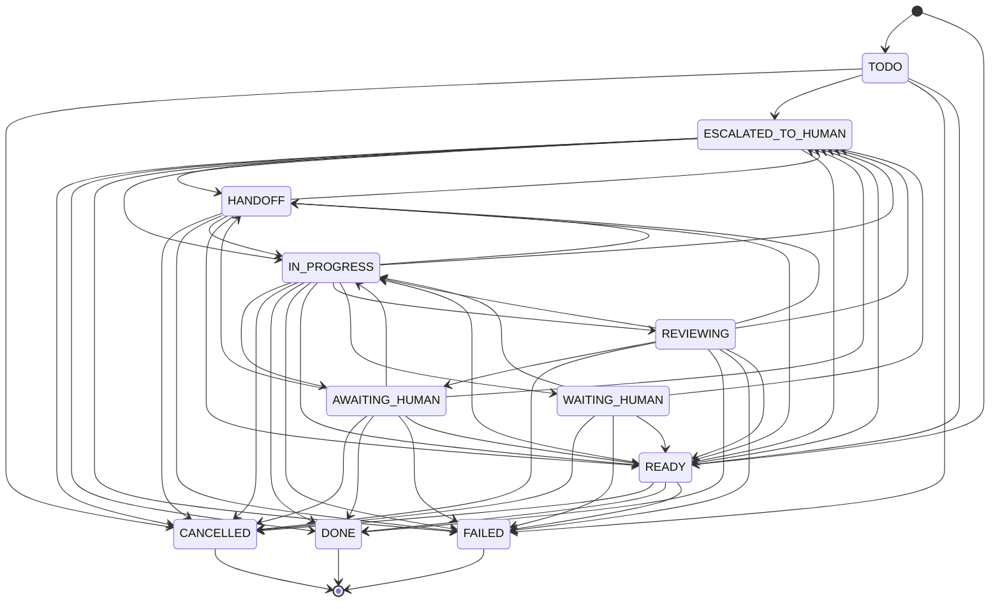

| from | to | why |
|---|---|---|
| `AWAITING_HUMAN` | `CANCELLED` | cancelled by its owner or with its parent |
| `AWAITING_HUMAN` | `DONE` | a person decides |
| `AWAITING_HUMAN` | `ESCALATED_TO_HUMAN` | escalated, or rejected too many times |
| `AWAITING_HUMAN` | `FAILED` | failed by its owner |
| `AWAITING_HUMAN` | `HANDOFF` | a person decides |
| `AWAITING_HUMAN` | `IN_PROGRESS` | a person decides |
| `AWAITING_HUMAN` | `READY` | a person decides |
| `ESCALATED_TO_HUMAN` | `CANCELLED` | cancelled by its owner or with its parent |
| `ESCALATED_TO_HUMAN` | `DONE` | a person decides |
| `ESCALATED_TO_HUMAN` | `FAILED` | failed by its owner |
| `ESCALATED_TO_HUMAN` | `HANDOFF` | a person decides |
| `ESCALATED_TO_HUMAN` | `IN_PROGRESS` | a person decides |
| `ESCALATED_TO_HUMAN` | `READY` | a person decides |
| `HANDOFF` | `CANCELLED` | cancelled by its owner or with its parent |
| `HANDOFF` | `ESCALATED_TO_HUMAN` | escalated, or rejected too many times |
| `HANDOFF` | `FAILED` | failed by its owner |
| `HANDOFF` | `IN_PROGRESS` | the next agent claims the work left for it |
| `HANDOFF` | `READY` | the scheduler reopens work put down, or tries a stopped task again |
| `IN_PROGRESS` | `AWAITING_HUMAN` | the holder hands it off (DONE when the work is trusted) |
| `IN_PROGRESS` | `CANCELLED` | cancelled by its owner or with its parent |
| `IN_PROGRESS` | `DONE` | the holder hands it off (DONE when the work is trusted) |
| `IN_PROGRESS` | `ESCALATED_TO_HUMAN` | escalated, or rejected too many times |
| `IN_PROGRESS` | `FAILED` | the holder hands it off (DONE when the work is trusted) |
| `IN_PROGRESS` | `HANDOFF` | the holder hands it off (DONE when the work is trusted) |
| `IN_PROGRESS` | `READY` | released, lease lost, or the dispatch was not acknowledged |
| `IN_PROGRESS` | `REVIEWING` | the holder hands it off (DONE when the work is trusted) |
| `IN_PROGRESS` | `WAITING_HUMAN` | the holder asks a person a question |
| `READY` | `CANCELLED` | cancelled by its owner or with its parent |
| `READY` | `DONE` | an escalation is answered or a peer review submitted: those tasks are done without a claim |
| `READY` | `ESCALATED_TO_HUMAN` | escalated, or rejected too many times |
| `READY` | `FAILED` | failed by its owner |
| `READY` | `HANDOFF` | the scheduler stops a task that failed on computers three times |
| `READY` | `IN_PROGRESS` | an agent or computer claims it (a lease starts) |
| `REVIEWING` | `AWAITING_HUMAN` | a review: approved, rejected (to the board or back to its holder), relayed, or passed to a person |
| `REVIEWING` | `CANCELLED` | cancelled by its owner or with its parent |
| `REVIEWING` | `DONE` | a review: approved, rejected (to the board or back to its holder), relayed, or passed to a person |
| `REVIEWING` | `ESCALATED_TO_HUMAN` | escalated, or rejected too many times |
| `REVIEWING` | `FAILED` | failed by its owner |
| `REVIEWING` | `HANDOFF` | a review: approved, rejected (to the board or back to its holder), relayed, or passed to a person |
| `REVIEWING` | `IN_PROGRESS` | a review: approved, rejected (to the board or back to its holder), relayed, or passed to a person |
| `REVIEWING` | `READY` | a review: approved, rejected (to the board or back to its holder), relayed, or passed to a person |
| `TODO` | `CANCELLED` | cancelled by its owner or with its parent |
| `TODO` | `ESCALATED_TO_HUMAN` | escalated, or rejected too many times |
| `TODO` | `FAILED` | failed by its owner |
| `TODO` | `READY` | every task it depends on is done |
| `WAITING_HUMAN` | `CANCELLED` | cancelled by its owner or with its parent |
| `WAITING_HUMAN` | `ESCALATED_TO_HUMAN` | escalated, or rejected too many times |
| `WAITING_HUMAN` | `FAILED` | failed by its owner |
| `WAITING_HUMAN` | `IN_PROGRESS` | the question was answered |
| `WAITING_HUMAN` | `READY` | reassigned and put back on the board |

## task_dispatch

`collab_tasks.dispatch_state`: A task's delivery to a computer over the nerve socket: two receipts, then the lease.

| state | meaning | next |
|---|---|---|
| `IDLE` (start) | Not being delivered. | `AWAITING_NET_ACK` |
| `AWAITING_NET_ACK` | Sent; waits for the computer to say it read it. | `AWAITING_EXEC_ACK`, `IDLE` |
| `AWAITING_EXEC_ACK` | Read; waits for the worker process to start. | `ACTIVE_LEASE`, `IDLE` |
| `ACTIVE_LEASE` | The worker started and holds the lease. | `IDLE` |

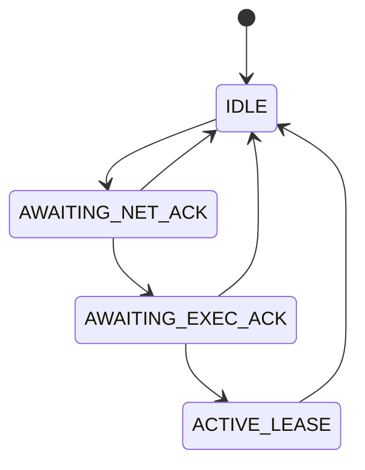

| from | to | why |
|---|---|---|
| `ACTIVE_LEASE` | `IDLE` | the lease ended (the task left IN_PROGRESS) |
| `AWAITING_EXEC_ACK` | `ACTIVE_LEASE` | the worker started |
| `AWAITING_EXEC_ACK` | `IDLE` | the worker did not start in time, or the task moved on |
| `AWAITING_NET_ACK` | `AWAITING_EXEC_ACK` | the computer read it |
| `AWAITING_NET_ACK` | `IDLE` | no receipt in time, or the task moved on |
| `IDLE` | `AWAITING_NET_ACK` | the hub sends the task |

## runner_placement

`runner_placements.status`: One step of a task (or a supervise round) put on a computer by the scheduler.

| state | meaning | next |
|---|---|---|
| `suggested` (start) | Proposed to a person (manual and semi modes). | `claimed`, `offered`, `superseded`, `withdrawn` |
| `offered` (start) | Given to a computer; waits for it to take it. | `claimed`, `delivered`, `failed`, `moved`, `superseded`, `withdrawn` |
| `claimed` | The computer took it and works on it. | `delivered`, `failed`, `moved`, `superseded`, `withdrawn` |
| `unplaced` (start) | No computer fits; the reason is on the row. | `offered`, `suggested`, `superseded`, `withdrawn` |
| `delivered` (end) | The step finished. | — |
| `failed` (end) | The step failed on that computer. | — |
| `moved` (end) | Taken away to another computer (offline, out of quota, not taken in time). | — |
| `superseded` (end) | A newer placement of the same step replaced it. | — |
| `withdrawn` (end) | No longer needed: the task moved on, or a person declined. | — |

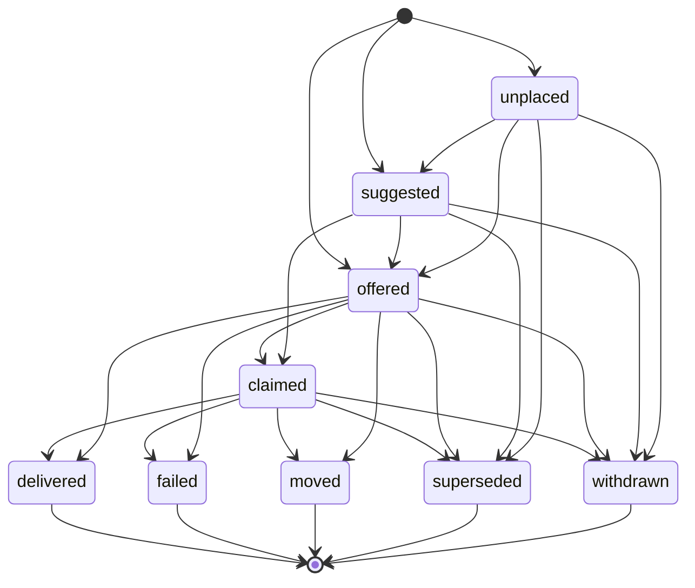

| from | to | why |
|---|---|---|
| `claimed` | `delivered` | the step finished |
| `claimed` | `failed` | the computer reported a failure, or the worker exited |
| `claimed` | `moved` | the computer went offline or out of quota |
| `claimed` | `superseded` | a newer placement of the same step replaced it |
| `claimed` | `withdrawn` | the task moved on, or a person declined |
| `offered` | `claimed` | the computer takes the step |
| `offered` | `delivered` | the step finished before it was seen taken |
| `offered` | `failed` | not taken in time, or the computer reported a failure |
| `offered` | `moved` | the computer went offline or out of quota |
| `offered` | `superseded` | a newer placement of the same step replaced it |
| `offered` | `withdrawn` | the task moved on, or a person declined |
| `suggested` | `claimed` | a person accepts the suggestion |
| `suggested` | `offered` | a person accepts the suggestion |
| `suggested` | `superseded` | a newer placement of the same step replaced it |
| `suggested` | `withdrawn` | the task moved on, or a person declined |
| `unplaced` | `offered` | a computer that fits came online |
| `unplaced` | `suggested` | a computer that fits came online |
| `unplaced` | `superseded` | a newer placement of the same step replaced it |
| `unplaced` | `withdrawn` | the task moved on, or a person declined |

## runner_placement_report

`runner_placements.reported`: What the computer said about how a placement ended. Written once.

| state | meaning | next |
|---|---|---|
| `finished` (end) | The worker said it finished. | — |
| `failed` (end) | The worker said it failed, or exited without a word. | — |
| `skipped` (end) | The worker arrived after the placement had moved on and did nothing. | — |

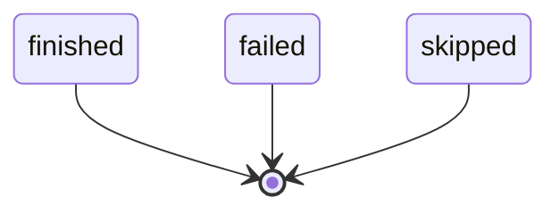

| from | to | why |
|---|---|---|

## runner_host

`runner_hosts.status`: A computer connected to run the Loop's work.

| state | meaning | next |
|---|---|---|
| `active` (start) | Takes work. | `paused`, `revoked` |
| `paused` | Takes no new work; its owner paused it. | `active`, `revoked` |
| `revoked` (end) | Removed for good; its token no longer works. | — |

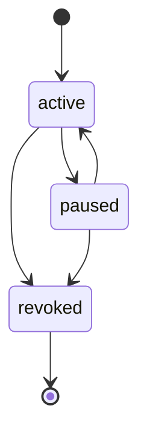

| from | to | why |
|---|---|---|
| `active` | `paused` | its owner pauses it |
| `active` | `revoked` | its owner removes it |
| `paused` | `active` | its owner resumes it |
| `paused` | `revoked` | its owner removes it |

## deploy_run

`deploy_runs.status`: One deployment of a release to a target.

| state | meaning | next |
|---|---|---|
| `queued` (start) | Waits for its turn on the target. | `offered`, `skipped` |
| `offered` | Given to a computer to deploy. | `deployed`, `failed`, `queued`, `rolled_back`, `running`, `skipped` |
| `running` | Deploying. | `deployed`, `failed`, `rolled_back` |
| `deployed` (end) | Live. | — |
| `rolled_back` (end) | Deployed, failed its check, and was rolled back. | — |
| `failed` (end) | Did not deploy. | — |
| `skipped` (end) | A newer release made it unnecessary. | — |

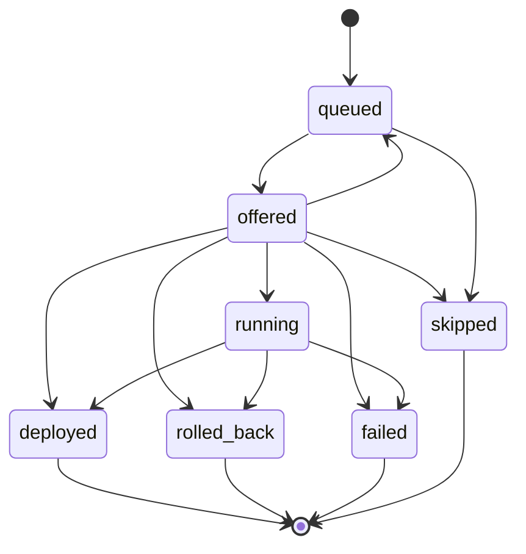

| from | to | why |
|---|---|---|
| `offered` | `deployed` | the computer reported how it ended before it was seen running |
| `offered` | `failed` | the computer reported how it ended before it was seen running |
| `offered` | `queued` | the computer did not take it in time |
| `offered` | `rolled_back` | the computer reported how it ended before it was seen running |
| `offered` | `running` | the computer started it |
| `offered` | `skipped` | a newer release for the same target came first |
| `queued` | `offered` | a computer that can deploy it is free |
| `queued` | `skipped` | a newer release for the same target came first |
| `running` | `deployed` | the computer reported how it ended |
| `running` | `failed` | the computer reported how it ended |
| `running` | `rolled_back` | the computer reported how it ended |

## external_action

`external_actions.status`: An action with an effect outside the platform, drafted by an agent.

| state | meaning | next |
|---|---|---|
| `PENDING_APPROVAL` (start) | Drafted; waits for a person to approve it. | `APPROVED`, `CANCELLED`, `REJECTED` |
| `APPROVED` | Approved; waits to run (or to be retried). | `CANCELLED`, `EXECUTING` |
| `EXECUTING` | Running. | `APPROVED`, `FAILED`, `SUCCEEDED` |
| `SUCCEEDED` | Ran. | `COMPENSATION_PENDING` |
| `FAILED` (end) | Ran and failed for good. | — |
| `REJECTED` (end) | A person said no. | — |
| `COMPENSATION_PENDING` | Ran; its undo was asked for. | `COMPENSATED` |
| `COMPENSATED` (end) | Undone. | — |
| `CANCELLED` (end) | Called off before it ran. | — |

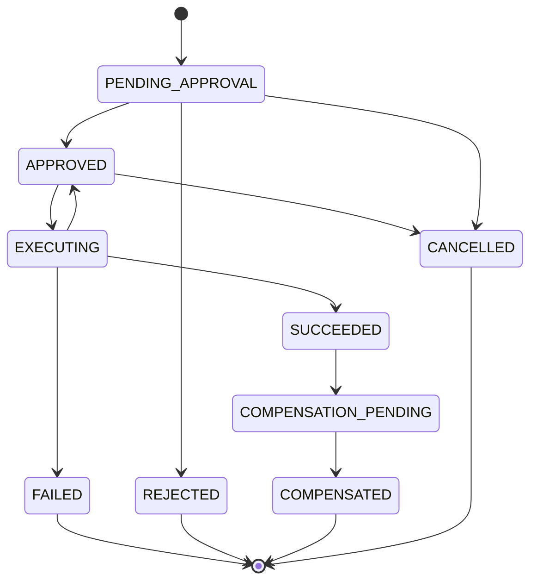

| from | to | why |
|---|---|---|
| `APPROVED` | `CANCELLED` | called off |
| `APPROVED` | `EXECUTING` | the worker runs it |
| `COMPENSATION_PENDING` | `COMPENSATED` | its undo ran |
| `EXECUTING` | `APPROVED` | it failed and will be retried |
| `EXECUTING` | `FAILED` | it failed and no retry is left |
| `EXECUTING` | `SUCCEEDED` | it ran |
| `PENDING_APPROVAL` | `APPROVED` | a person approves it |
| `PENDING_APPROVAL` | `CANCELLED` | called off |
| `PENDING_APPROVAL` | `REJECTED` | a person rejects it |
| `SUCCEEDED` | `COMPENSATION_PENDING` | its undo was asked for |

## webhook_delivery

`webhook_deliveries.status`: One delivery of an event to a subscriber's URL.

| state | meaning | next |
|---|---|---|
| `PENDING` (start) | Waits to be sent (or retried). | `CANCELED`, `DEAD`, `FAILED`, `SUCCEEDED` |
| `SUCCEEDED` (end) | The subscriber took it. | — |
| `FAILED` (end) | This attempt failed; it will not be retried. | — |
| `CANCELED` (end) | The subscription went away. | — |
| `DEAD` (end) | Every retry failed. | — |

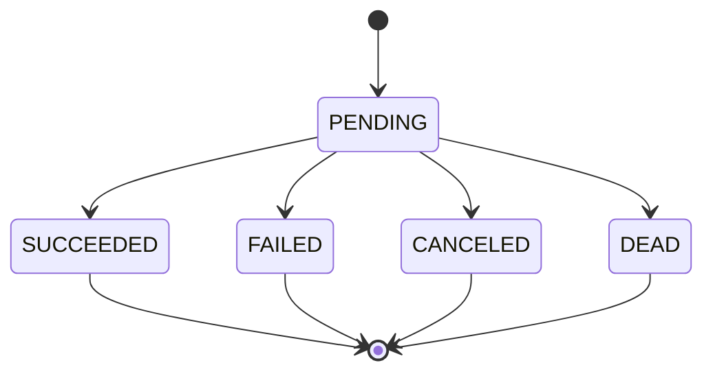

| from | to | why |
|---|---|---|
| `PENDING` | `CANCELED` | the subscription was removed |
| `PENDING` | `DEAD` | the last retry failed |
| `PENDING` | `FAILED` | the subscriber refused it for good |
| `PENDING` | `SUCCEEDED` | the subscriber answered 2xx |

## document_verification

`shared_documents.verification_status`: How far a shared document is trusted.

| state | meaning | next |
|---|---|---|
| `DRAFT` (start) | Written; not checked. | `PENDING_REVIEW`, `VERIFIED` |
| `PENDING_REVIEW` | Waits for a review. | `DRAFT`, `VERIFIED` |
| `VERIFIED` | Checked and trusted. | `DEPRECATED`, `DRAFT` |
| `DEPRECATED` | Kept for the record; do not rely on it. | `DRAFT`, `VERIFIED` |

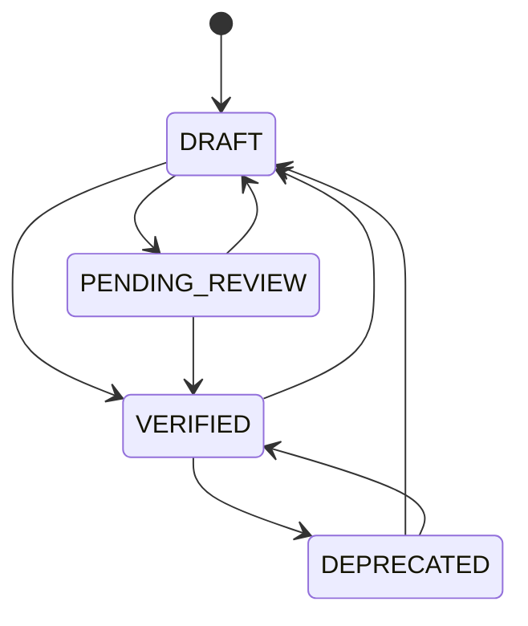

| from | to | why |
|---|---|---|
| `DEPRECATED` | `DRAFT` | verified again, or edited |
| `DEPRECATED` | `VERIFIED` | verified again, or edited |
| `DRAFT` | `PENDING_REVIEW` | sent for review, or verified |
| `DRAFT` | `VERIFIED` | sent for review, or verified |
| `PENDING_REVIEW` | `DRAFT` | the review passed, or the document changed |
| `PENDING_REVIEW` | `VERIFIED` | the review passed, or the document changed |
| `VERIFIED` | `DEPRECATED` | edited again, or deprecated |
| `VERIFIED` | `DRAFT` | edited again, or deprecated |

## lease

`leases.state`: A time-limited hold on a task, slot or resource.

| state | meaning | next |
|---|---|---|
| `active` (start) | Held. | `expired`, `released`, `revoked` |
| `released` (end) | Given back by its holder. | — |
| `expired` (end) | Its time ran out. | — |
| `revoked` (end) | Taken away (the work moved on or the holder was removed). | — |

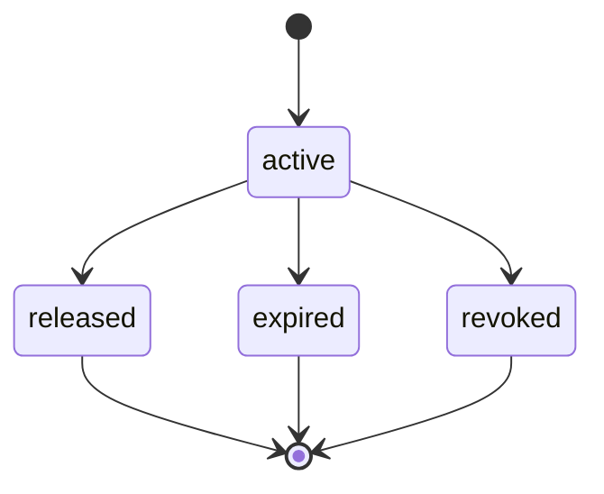

| from | to | why |
|---|---|---|
| `active` | `expired` | its time ran out |
| `active` | `released` | its holder gives it back or finishes |
| `active` | `revoked` | taken away |

## document_index

`document_index.state`: A document's place in the search index.

| state | meaning | next |
|---|---|---|
| `pending` (start) | Waits to be embedded. | `deferred`, `failed`, `indexed` |
| `indexed` | Searchable. | `pending` |
| `failed` | Could not be embedded. | `pending` |
| `deferred` | Waits for embedding budget. | `indexed`, `pending` |

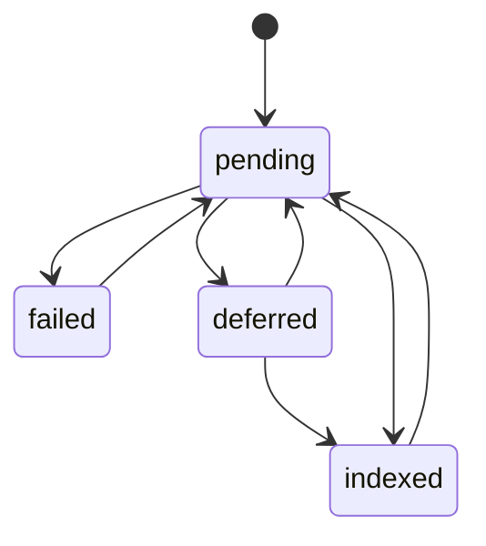

| from | to | why |
|---|---|---|
| `deferred` | `indexed` | budget came back |
| `deferred` | `pending` | budget came back |
| `failed` | `pending` | retried |
| `indexed` | `pending` | the document changed |
| `pending` | `deferred` | the worker embedded it, failed, or ran out of budget |
| `pending` | `failed` | the worker embedded it, failed, or ran out of budget |
| `pending` | `indexed` | the worker embedded it, failed, or ran out of budget |

## mcp_connection

`mcp_connections.status`: An MCP client connected to a workspace (one per installation).

| state | meaning | next |
|---|---|---|
| `active` (start) | In use. | `dormant`, `revoked` |
| `dormant` | Unused for a while; its credential still works and wakes it. | `active`, `revoked` |
| `revoked` (end) | Removed; its credential no longer works. | — |

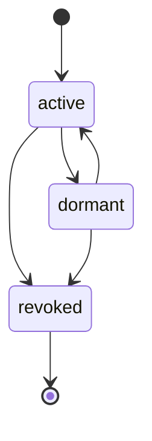

| from | to | why |
|---|---|---|
| `active` | `dormant` | not used for the dormant period |
| `active` | `revoked` | removed by a person, or unused past the revoke period |
| `dormant` | `active` | used again |
| `dormant` | `revoked` | removed by a person, or unused past the revoke period |

## cli_session

`cli_sessions.status`: A sign-in started by the command line.

| state | meaning | next |
|---|---|---|
| `pending` (start) | Waits for a person to approve it in the browser. | `approved`, `denied` |
| `approved` | Approved; waits for the client to pick up its credential. | `consumed` |
| `denied` (end) | A person said no. | — |
| `consumed` (end) | The client picked up its credential. | — |

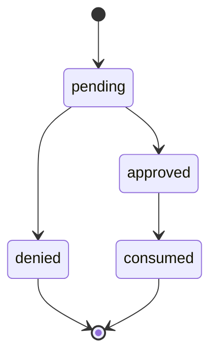

| from | to | why |
|---|---|---|
| `approved` | `consumed` | the CLI picked up its credential |
| `pending` | `approved` | a person answers in the browser |
| `pending` | `denied` | a person answers in the browser |

## oauth_request

`oauth_requests.status`: A sign-in started by an OAuth client.

| state | meaning | next |
|---|---|---|
| `pending` (start) | Waits for a person to approve it in the browser. | `approved`, `denied` |
| `approved` | Approved; waits for the client to pick up its credential. | `consumed` |
| `denied` (end) | A person said no. | — |
| `consumed` (end) | The client picked up its credential. | — |


| from | to | why |
|---|---|---|
| `approved` | `consumed` | the client exchanged the code |
| `pending` | `approved` | a person answers in the browser |
| `pending` | `denied` | a person answers in the browser |

## tenant

`tenants.status`: An organisation on the platform.

| state | meaning | next |
|---|---|---|
| `active` (start) | In use. | `deleting`, `suspended` |
| `suspended` | Reads only; an operator suspended it. | `active`, `deleting` |
| `deleting` | In its deletion grace period; can still be restored. | `active`, `deleted` |
| `deleted` (end) | Gone. | — |

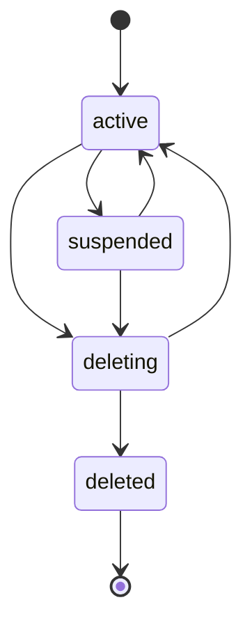

| from | to | why |
|---|---|---|
| `active` | `deleting` | an operator suspends it, or its owner deletes it |
| `active` | `suspended` | an operator suspends it, or its owner deletes it |
| `deleting` | `active` | restored within the grace period |
| `deleting` | `deleted` | the grace period ended |
| `suspended` | `active` | restored, or deleted |
| `suspended` | `deleting` | restored, or deleted |

## document_proposal

`document_proposals.status`: A proposed change to a protected document.

| state | meaning | next |
|---|---|---|
| `PENDING` (start) | Waits for votes or a person. | `APPLIED`, `REJECTED`, `SUPERSEDED` |
| `APPLIED` (end) | Applied to the document. | — |
| `REJECTED` (end) | Turned down. | — |
| `SUPERSEDED` (end) | Another proposal for the same document was applied. | — |

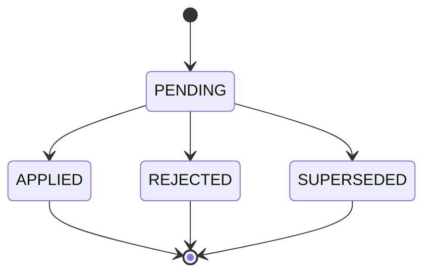

| from | to | why |
|---|---|---|
| `PENDING` | `APPLIED` | a person applies, rejects, or applies another |
| `PENDING` | `REJECTED` | a person applies, rejects, or applies another |
| `PENDING` | `SUPERSEDED` | a person applies, rejects, or applies another |

## diagram

`diagrams.status`: A project's work diagram.

| state | meaning | next |
|---|---|---|
| `draft` (start) | Being drawn. | `confirmed` |
| `confirmed` | Agreed; chunks can be planned. | `frozen` |
| `frozen` (end) | Fixed; its chunks are dispatched as work. | — |

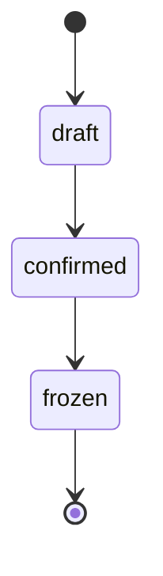

| from | to | why |
|---|---|---|
| `confirmed` | `frozen` | its owner freezes it |
| `draft` | `confirmed` | its owner confirms it |

## diagram_chunk

`diagram_chunks.state`: One piece of a frozen diagram's work.

| state | meaning | next |
|---|---|---|
| `pending` (start) | Waits for what it depends on. | `blocked`, `dispatched`, `retired`, `suspended` |
| `dispatched` | Its task is on the board. | `blocked`, `merged`, `retired`, `rework`, `suspended` |
| `blocked` | Cannot go on; the reason is on the row. | `dispatched`, `pending`, `retired`, `suspended` |
| `rework` | Sent back for another round. | `blocked`, `dispatched`, `retired`, `suspended` |
| `merged` (end) | Its code was merged. | — |
| `retired` (end) | Removed from the diagram by an approved change. | — |
| `suspended` | Held while a change to the diagram is decided. | `dispatched`, `pending`, `retired` |

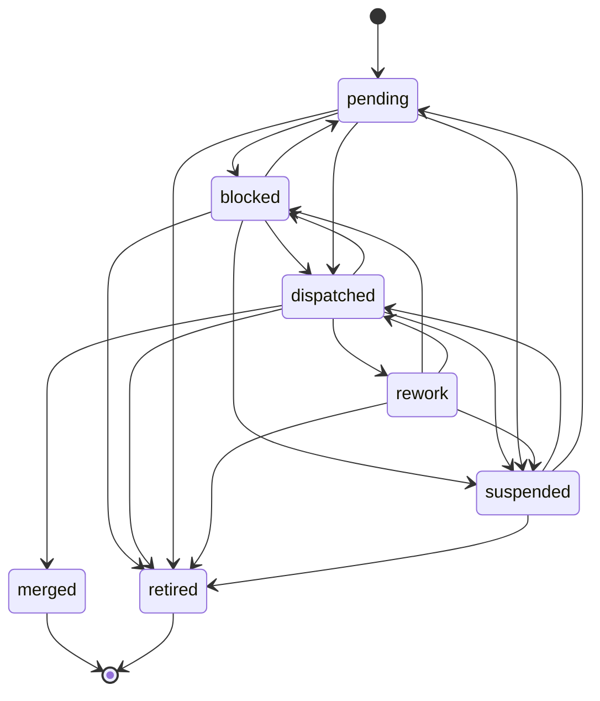

| from | to | why |
|---|---|---|
| `blocked` | `dispatched` | unblocked |
| `blocked` | `pending` | unblocked |
| `blocked` | `retired` | an approved change removed it |
| `blocked` | `suspended` | a change to the diagram is being decided |
| `dispatched` | `blocked` | merged, sent back, or blocked |
| `dispatched` | `merged` | merged, sent back, or blocked |
| `dispatched` | `retired` | an approved change removed it |
| `dispatched` | `rework` | merged, sent back, or blocked |
| `dispatched` | `suspended` | a change to the diagram is being decided |
| `pending` | `blocked` | its dependencies merged, or it cannot start |
| `pending` | `dispatched` | its dependencies merged, or it cannot start |
| `pending` | `retired` | an approved change removed it |
| `pending` | `suspended` | a change to the diagram is being decided |
| `rework` | `blocked` | dispatched again, or blocked |
| `rework` | `dispatched` | dispatched again, or blocked |
| `rework` | `retired` | an approved change removed it |
| `rework` | `suspended` | a change to the diagram is being decided |
| `suspended` | `dispatched` | the change was decided |
| `suspended` | `pending` | the change was decided |
| `suspended` | `retired` | an approved change removed it |

## diagram_change

`diagram_changes.status`: A proposed change to a frozen diagram.

| state | meaning | next |
|---|---|---|
| `pending` (start) | Waits for a decision. | `approved`, `rejected` |
| `approved` | Applied. | `revoked` |
| `rejected` (end) | Turned down. | — |
| `revoked` (end) | Approved, then taken back. | — |

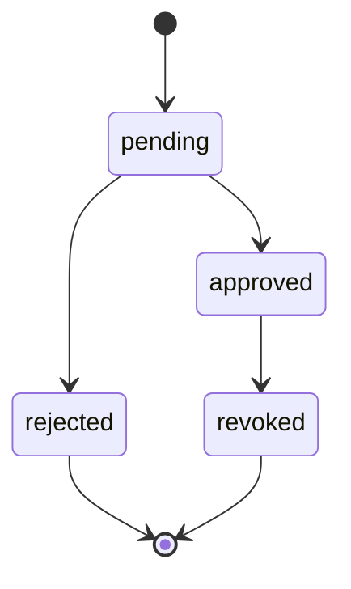

| from | to | why |
|---|---|---|
| `approved` | `revoked` | a person takes it back |
| `pending` | `approved` | a person decides |
| `pending` | `rejected` | a person decides |

## change_claim

`change_claims.status`: An agent's claim that it changed something, until checked.

| state | meaning | next |
|---|---|---|
| `CLAIMED` (start) | Claimed; not checked. | `REFUTED`, `VERIFIED` |
| `VERIFIED` (end) | Checked and true. | — |
| `REFUTED` (end) | Checked and false. | — |

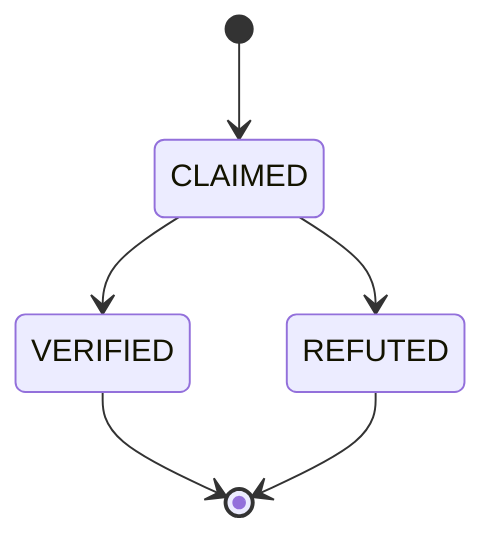

| from | to | why |
|---|---|---|
| `CLAIMED` | `REFUTED` | the claim was checked |
| `CLAIMED` | `VERIFIED` | the claim was checked |

## audit_sample

`audit_samples.verdict`: A finished task drawn for a quality audit.

| state | meaning | next |
|---|---|---|
| `PENDING` (start) | Waits for an auditor. | `DEFECT`, `OK` |
| `OK` (end) | Fine. | — |
| `DEFECT` (end) | A defect was found. | — |

```mermaid
stateDiagram-v2
    [*] --> s_PENDING
    s_PENDING : PENDING
    s_OK : OK
    s_DEFECT : DEFECT
    s_PENDING --> s_DEFECT
    s_PENDING --> s_OK
    s_OK --> [*]
    s_DEFECT --> [*]
```

| from | to | why |
|---|---|---|
| `PENDING` | `DEFECT` | the auditor decided |
| `PENDING` | `OK` | the auditor decided |

## defect_escape

`defect_escapes.status`: A defect found after a task was done.

| state | meaning | next |
|---|---|---|
| `OPEN` (start) | Not dealt with. | `FIXED`, `WAIVED` |
| `FIXED` (end) | Fixed. | — |
| `WAIVED` (end) | Accepted as it is. | — |

```mermaid
stateDiagram-v2
    [*] --> s_OPEN
    s_OPEN : OPEN
    s_FIXED : FIXED
    s_WAIVED : WAIVED
    s_OPEN --> s_FIXED
    s_OPEN --> s_WAIVED
    s_FIXED --> [*]
    s_WAIVED --> [*]
```

| from | to | why |
|---|---|---|
| `OPEN` | `FIXED` | fixed or waived |
| `OPEN` | `WAIVED` | fixed or waived |

## quality_circuit

`quality_circuit.state`: Stops automatic acceptance in a scope after too many defects.

| state | meaning | next |
|---|---|---|
| `CLOSED` (start) | Work flows. | `OPEN` |
| `OPEN` | Work in the scope waits for people. | `CLOSED` |

```mermaid
stateDiagram-v2
    [*] --> s_CLOSED
    s_CLOSED : CLOSED
    s_OPEN : OPEN
    s_CLOSED --> s_OPEN
    s_OPEN --> s_CLOSED
```

| from | to | why |
|---|---|---|
| `CLOSED` | `OPEN` | too many defects in the scope |
| `OPEN` | `CLOSED` | a person closed it, or it cooled down |

## situation_alert

`situation_alerts.state`: An alert about the platform's or a workspace's health.

| state | meaning | next |
|---|---|---|
| `open` (start) | New. | `acked`, `resolved` |
| `acked` | Someone is on it. | `resolved` |
| `resolved` (end) | Over. | — |

```mermaid
stateDiagram-v2
    [*] --> s_open
    s_open : open
    s_acked : acked
    s_resolved : resolved
    s_acked --> s_resolved
    s_open --> s_acked
    s_open --> s_resolved
    s_resolved --> [*]
```

| from | to | why |
|---|---|---|
| `acked` | `resolved` | the cause went away |
| `open` | `acked` | acknowledged, or the cause went away |
| `open` | `resolved` | acknowledged, or the cause went away |

## escalation

`escalations.status`: A question raised to people.

| state | meaning | next |
|---|---|---|
| `open` (start) | Waits for an answer. | `resolved` |
| `resolved` (end) | Answered. | — |

```mermaid
stateDiagram-v2
    [*] --> s_open
    s_open : open
    s_resolved : resolved
    s_open --> s_resolved
    s_resolved --> [*]
```

| from | to | why |
|---|---|---|
| `open` | `resolved` | a person answered |

## recall

`recalls.status`: A recall of a document and what was built on it.

| state | meaning | next |
|---|---|---|
| `open` (start) | Being worked through. | `closed` |
| `closed` (end) | Done. | — |

```mermaid
stateDiagram-v2
    [*] --> s_open
    s_open : open
    s_closed : closed
    s_open --> s_closed
    s_closed --> [*]
```

| from | to | why |
|---|---|---|
| `open` | `closed` | every affected item was dealt with |

## recall_node

`recall_nodes.status`: One item affected by a recall.

| state | meaning | next |
|---|---|---|
| `open` (start) | Not dealt with. | `dismissed`, `resolved` |
| `resolved` (end) | Dealt with. | — |
| `dismissed` (end) | Not affected. | — |

```mermaid
stateDiagram-v2
    [*] --> s_open
    s_open : open
    s_resolved : resolved
    s_dismissed : dismissed
    s_open --> s_dismissed
    s_open --> s_resolved
    s_resolved --> [*]
    s_dismissed --> [*]
```

| from | to | why |
|---|---|---|
| `open` | `dismissed` | dealt with, or dismissed |
| `open` | `resolved` | dealt with, or dismissed |

## rights_request

`rights_requests.status`: A data subject's request.

| state | meaning | next |
|---|---|---|
| `open` (start) | Received. | `closed`, `located`, `rejected` |
| `located` | Their data was found. | `closed`, `fulfilled`, `rejected` |
| `fulfilled` | Answered. | `closed` |
| `rejected` | Refused, with the reason. | `closed` |
| `closed` (end) | Over. | — |

```mermaid
stateDiagram-v2
    [*] --> s_open
    s_open : open
    s_located : located
    s_fulfilled : fulfilled
    s_rejected : rejected
    s_closed : closed
    s_fulfilled --> s_closed
    s_located --> s_closed
    s_located --> s_fulfilled
    s_located --> s_rejected
    s_open --> s_closed
    s_open --> s_located
    s_open --> s_rejected
    s_rejected --> s_closed
    s_closed --> [*]
```

| from | to | why |
|---|---|---|
| `fulfilled` | `closed` | closed after the answer |
| `located` | `closed` | answered, refused or closed |
| `located` | `fulfilled` | answered, refused or closed |
| `located` | `rejected` | answered, refused or closed |
| `open` | `closed` | the data was found, or the request refused or closed |
| `open` | `located` | the data was found, or the request refused or closed |
| `open` | `rejected` | the data was found, or the request refused or closed |
| `rejected` | `closed` | closed after the refusal |

## incident

`incidents.status`: A security incident and its notices.

| state | meaning | next |
|---|---|---|
| `investigating` (start) | Being looked into. | `closed`, `confirmed` |
| `confirmed` | Real. | `closed`, `notifying` |
| `notifying` | Those affected are being told. | `closed` |
| `closed` (end) | Over. | — |

```mermaid
stateDiagram-v2
    [*] --> s_investigating
    s_investigating : investigating
    s_confirmed : confirmed
    s_notifying : notifying
    s_closed : closed
    s_confirmed --> s_closed
    s_confirmed --> s_notifying
    s_investigating --> s_closed
    s_investigating --> s_confirmed
    s_notifying --> s_closed
    s_closed --> [*]
```

| from | to | why |
|---|---|---|
| `confirmed` | `closed` | notices start, or it is closed |
| `confirmed` | `notifying` | notices start, or it is closed |
| `investigating` | `closed` | confirmed, or closed as nothing |
| `investigating` | `confirmed` | confirmed, or closed as nothing |
| `notifying` | `closed` | every notice went out |

## backup

`backups.status`: A database backup.

| state | meaning | next |
|---|---|---|
| `running` (start) | Being taken. | `done`, `failed` |
| `done` | Taken. | `expired` |
| `failed` (end) | Failed. | — |
| `expired` (end) | Past its retention; removed. | — |

```mermaid
stateDiagram-v2
    [*] --> s_running
    s_running : running
    s_done : done
    s_failed : failed
    s_expired : expired
    s_done --> s_expired
    s_running --> s_done
    s_running --> s_failed
    s_failed --> [*]
    s_expired --> [*]
```

| from | to | why |
|---|---|---|
| `done` | `expired` | its retention ran out |
| `running` | `done` | it ended |
| `running` | `failed` | it ended |

## export

`exports.status`: A workspace export.

| state | meaning | next |
|---|---|---|
| `queued` (start) | Waits to run. | `failed`, `running` |
| `running` | Running. | `done`, `failed` |
| `done` (end) | Finished. | — |
| `failed` (end) | Failed. | — |

```mermaid
stateDiagram-v2
    [*] --> s_queued
    s_queued : queued
    s_running : running
    s_done : done
    s_failed : failed
    s_queued --> s_failed
    s_queued --> s_running
    s_running --> s_done
    s_running --> s_failed
    s_done --> [*]
    s_failed --> [*]
```

| from | to | why |
|---|---|---|
| `queued` | `failed` | it started, or could not |
| `queued` | `running` | it started, or could not |
| `running` | `done` | it ended |
| `running` | `failed` | it ended |

## import

`imports.status`: A workspace import.

| state | meaning | next |
|---|---|---|
| `running` (start) | Running. | `done`, `failed` |
| `done` (end) | Finished. | — |
| `failed` (end) | Failed. | — |

```mermaid
stateDiagram-v2
    [*] --> s_running
    s_running : running
    s_done : done
    s_failed : failed
    s_running --> s_done
    s_running --> s_failed
    s_done --> [*]
    s_failed --> [*]
```

| from | to | why |
|---|---|---|
| `running` | `done` | it ended |
| `running` | `failed` | it ended |

## restore_run

`restore_runs.status`: A restore from a backup.

| state | meaning | next |
|---|---|---|
| `running` (start) | Running. | `done`, `failed` |
| `done` (end) | Finished. | — |
| `failed` (end) | Failed. | — |

```mermaid
stateDiagram-v2
    [*] --> s_running
    s_running : running
    s_done : done
    s_failed : failed
    s_running --> s_done
    s_running --> s_failed
    s_done --> [*]
    s_failed --> [*]
```

| from | to | why |
|---|---|---|
| `running` | `done` | it ended |
| `running` | `failed` | it ended |

## restore_drill

`restore_drills.status`: A practice restore.

| state | meaning | next |
|---|---|---|
| `running` (start) | Running. | `failed`, `passed` |
| `passed` (end) | The backup restored. | — |
| `failed` (end) | It did not. | — |

```mermaid
stateDiagram-v2
    [*] --> s_running
    s_running : running
    s_passed : passed
    s_failed : failed
    s_running --> s_failed
    s_running --> s_passed
    s_passed --> [*]
    s_failed --> [*]
```

| from | to | why |
|---|---|---|
| `running` | `failed` | it ended |
| `running` | `passed` | it ended |

## email

`email_outbox.status`: An email waiting to go out.

| state | meaning | next |
|---|---|---|
| `queued` (start) | Waits to be sent. | `failed`, `no_transport`, `sent` |
| `sent` (end) | Sent. | — |
| `failed` (end) | Could not be sent. | — |
| `no_transport` (end) | No mail transport is set up. | — |

```mermaid
stateDiagram-v2
    [*] --> s_queued
    s_queued : queued
    s_sent : sent
    s_failed : failed
    s_no_transport : no_transport
    s_queued --> s_failed
    s_queued --> s_no_transport
    s_queued --> s_sent
    s_sent --> [*]
    s_failed --> [*]
    s_no_transport --> [*]
```

| from | to | why |
|---|---|---|
| `queued` | `failed` | the mail worker tried it |
| `queued` | `no_transport` | the mail worker tried it |
| `queued` | `sent` | the mail worker tried it |

## resource_ticket

`resource_queue.state`: A place in the queue for a shared resource.

| state | meaning | next |
|---|---|---|
| `waiting` (start) | In the queue. | `cancelled`, `offered` |
| `offered` | Its turn; must be taken soon. | `abandoned`, `cancelled`, `granted` |
| `granted` (end) | Taken. | — |
| `abandoned` (end) | Not taken in time. | — |
| `cancelled` (end) | Left the queue. | — |

```mermaid
stateDiagram-v2
    [*] --> s_waiting
    s_waiting : waiting
    s_offered : offered
    s_granted : granted
    s_abandoned : abandoned
    s_cancelled : cancelled
    s_offered --> s_abandoned
    s_offered --> s_cancelled
    s_offered --> s_granted
    s_waiting --> s_cancelled
    s_waiting --> s_offered
    s_granted --> [*]
    s_abandoned --> [*]
    s_cancelled --> [*]
```

| from | to | why |
|---|---|---|
| `offered` | `abandoned` | taken, not taken, or left |
| `offered` | `cancelled` | taken, not taken, or left |
| `offered` | `granted` | taken, not taken, or left |
| `waiting` | `cancelled` | its turn came, or it left |
| `waiting` | `offered` | its turn came, or it left |

## idempotency_record

`idempotency_records.status`: A request remembered so a retry gets the same answer.

| state | meaning | next |
|---|---|---|
| `in_progress` (start) | Being answered. | `completed` |
| `completed` (end) | Answered; a retry gets the answer. | — |

```mermaid
stateDiagram-v2
    [*] --> s_in_progress
    s_in_progress : in_progress
    s_completed : completed
    s_in_progress --> s_completed
    s_completed --> [*]
```

| from | to | why |
|---|---|---|
| `in_progress` | `completed` | the answer was stored |

## conversation

`conversations.status`: A conversation between members.

| state | meaning | next |
|---|---|---|
| `pending` (start) | Waits for the other side to accept. | `active` |
| `active` (start) | Open. | — |

```mermaid
stateDiagram-v2
    [*] --> s_pending
    [*] --> s_active
    s_pending : pending
    s_active : active
    s_pending --> s_active
    s_active --> [*]
```

| from | to | why |
|---|---|---|
| `pending` | `active` | the other side accepted |

## agent_onboarding

`agent_onboarding.state`: An agent's first steps.

| state | meaning | next |
|---|---|---|
| `new` (start) | Just connected. | `active`, `needs_ack`, `needs_first_action`, `needs_namespace_readme`, `needs_registration`, `oriented` |
| `oriented` | Read its orientation. | `active`, `needs_ack`, `needs_first_action`, `needs_namespace_readme`, `needs_registration` |
| `needs_ack` | Must acknowledge the constitution. | `active`, `needs_first_action`, `needs_namespace_readme`, `needs_registration` |
| `needs_namespace_readme` | Must read its namespace readme. | `active`, `needs_first_action`, `needs_registration` |
| `needs_registration` | Must register. | `active`, `needs_first_action` |
| `needs_first_action` | Must take its first action. | `active` |
| `active` (end) | Onboarded. | — |

```mermaid
stateDiagram-v2
    [*] --> s_new
    s_new : new
    s_oriented : oriented
    s_needs_ack : needs_ack
    s_needs_namespace_readme : needs_namespace_readme
    s_needs_registration : needs_registration
    s_needs_first_action : needs_first_action
    s_active : active
    s_needs_ack --> s_active
    s_needs_ack --> s_needs_first_action
    s_needs_ack --> s_needs_namespace_readme
    s_needs_ack --> s_needs_registration
    s_needs_first_action --> s_active
    s_needs_namespace_readme --> s_active
    s_needs_namespace_readme --> s_needs_first_action
    s_needs_namespace_readme --> s_needs_registration
    s_needs_registration --> s_active
    s_needs_registration --> s_needs_first_action
    s_new --> s_active
    s_new --> s_needs_ack
    s_new --> s_needs_first_action
    s_new --> s_needs_namespace_readme
    s_new --> s_needs_registration
    s_new --> s_oriented
    s_oriented --> s_active
    s_oriented --> s_needs_ack
    s_oriented --> s_needs_first_action
    s_oriented --> s_needs_namespace_readme
    s_oriented --> s_needs_registration
    s_active --> [*]
```

| from | to | why |
|---|---|---|
| `needs_ack` | `active` | the agent took a step |
| `needs_ack` | `needs_first_action` | the agent took a step |
| `needs_ack` | `needs_namespace_readme` | the agent took a step |
| `needs_ack` | `needs_registration` | the agent took a step |
| `needs_first_action` | `active` | the agent took its first action |
| `needs_namespace_readme` | `active` | the agent took a step |
| `needs_namespace_readme` | `needs_first_action` | the agent took a step |
| `needs_namespace_readme` | `needs_registration` | the agent took a step |
| `needs_registration` | `active` | the agent took a step |
| `needs_registration` | `needs_first_action` | the agent took a step |
| `new` | `active` | the agent took a step |
| `new` | `needs_ack` | the agent took a step |
| `new` | `needs_first_action` | the agent took a step |
| `new` | `needs_namespace_readme` | the agent took a step |
| `new` | `needs_registration` | the agent took a step |
| `new` | `oriented` | the agent took a step |
| `oriented` | `active` | the agent took a step |
| `oriented` | `needs_ack` | the agent took a step |
| `oriented` | `needs_first_action` | the agent took a step |
| `oriented` | `needs_namespace_readme` | the agent took a step |
| `oriented` | `needs_registration` | the agent took a step |

## member_status

`agent_directory.status`: A member of the directory.

| state | meaning | next |
|---|---|---|
| `active` (start) | Seen lately. | `idle`, `offline`, `retired` |
| `idle` | Not seen for a while. | `active`, `offline`, `retired` |
| `offline` | Gone quiet. | `active`, `idle`, `retired` |
| `retired` | Its tokens were revoked; it is kept for the record. | `active` |

```mermaid
stateDiagram-v2
    [*] --> s_active
    s_active : active
    s_idle : idle
    s_offline : offline
    s_retired : retired
    s_active --> s_idle
    s_active --> s_offline
    s_active --> s_retired
    s_idle --> s_active
    s_idle --> s_offline
    s_idle --> s_retired
    s_offline --> s_active
    s_offline --> s_idle
    s_offline --> s_retired
    s_retired --> s_active
```

| from | to | why |
|---|---|---|
| `active` | `idle` | not seen, or its tokens were revoked |
| `active` | `offline` | not seen, or its tokens were revoked |
| `active` | `retired` | not seen, or its tokens were revoked |
| `idle` | `active` | seen, not seen longer, or revoked |
| `idle` | `offline` | seen, not seen longer, or revoked |
| `idle` | `retired` | seen, not seen longer, or revoked |
| `offline` | `active` | seen again, or revoked |
| `offline` | `idle` | seen again, or revoked |
| `offline` | `retired` | seen again, or revoked |
| `retired` | `active` | merged back or given a new token |

## member_presence

`agent_directory.presence_state`: Whether a member can be reached now.

| state | meaning | next |
|---|---|---|
| `online` (start) | Connected. | `degraded`, `offline`, `unwakeable` |
| `offline` (start) | Not connected. | `degraded`, `online`, `unwakeable` |
| `degraded` | Connected but answering slowly. | `offline`, `online`, `unwakeable` |
| `unwakeable` (start) | Cannot be woken. | `degraded`, `offline`, `online` |

```mermaid
stateDiagram-v2
    [*] --> s_online
    [*] --> s_offline
    [*] --> s_unwakeable
    s_online : online
    s_offline : offline
    s_degraded : degraded
    s_unwakeable : unwakeable
    s_degraded --> s_offline
    s_degraded --> s_online
    s_degraded --> s_unwakeable
    s_offline --> s_degraded
    s_offline --> s_online
    s_offline --> s_unwakeable
    s_online --> s_degraded
    s_online --> s_offline
    s_online --> s_unwakeable
    s_unwakeable --> s_degraded
    s_unwakeable --> s_offline
    s_unwakeable --> s_online
```

| from | to | why |
|---|---|---|
| `degraded` | `offline` | its connection changed |
| `degraded` | `online` | its connection changed |
| `degraded` | `unwakeable` | its connection changed |
| `offline` | `degraded` | its connection changed |
| `offline` | `online` | its connection changed |
| `offline` | `unwakeable` | its connection changed |
| `online` | `degraded` | its connection changed |
| `online` | `offline` | its connection changed |
| `online` | `unwakeable` | its connection changed |
| `unwakeable` | `degraded` | its connection changed |
| `unwakeable` | `offline` | its connection changed |
| `unwakeable` | `online` | its connection changed |

## federation_contract

`federation_contracts.state`: A paid agreement between two workspaces on the federation market.

| state | meaning | next |
|---|---|---|
| `FUNDED` (start) | The price is held in escrow. | `CALLED`, `CANCELLED`, `DELIVERED`, `DISPUTED`, `INSTALLED` |
| `DELIVERED` | The work was delivered. | `ACCEPTED`, `DISPUTED` |
| `CANCELLED` | Called off; the price goes back. | `REFUNDED` |
| `DISPUTED` | The buyer disputes it. | `REFUNDED`, `RELEASED` |
| `ACCEPTED` | The buyer accepted the work. | `RELEASED` |
| `RELEASED` (end) | Paid to the seller. | — |
| `REFUNDED` (end) | Paid back to the buyer. | — |
| `INSTALLED` | The skill was installed. | `RELEASED` |
| `CALLED` | The tool was called. | `RELEASED` |

```mermaid
stateDiagram-v2
    [*] --> s_FUNDED
    s_FUNDED : FUNDED
    s_DELIVERED : DELIVERED
    s_CANCELLED : CANCELLED
    s_DISPUTED : DISPUTED
    s_ACCEPTED : ACCEPTED
    s_RELEASED : RELEASED
    s_REFUNDED : REFUNDED
    s_INSTALLED : INSTALLED
    s_CALLED : CALLED
    s_ACCEPTED --> s_RELEASED
    s_CALLED --> s_RELEASED
    s_CANCELLED --> s_REFUNDED
    s_DELIVERED --> s_ACCEPTED
    s_DELIVERED --> s_DISPUTED
    s_DISPUTED --> s_REFUNDED
    s_DISPUTED --> s_RELEASED
    s_FUNDED --> s_CALLED
    s_FUNDED --> s_CANCELLED
    s_FUNDED --> s_DELIVERED
    s_FUNDED --> s_DISPUTED
    s_FUNDED --> s_INSTALLED
    s_INSTALLED --> s_RELEASED
    s_RELEASED --> [*]
    s_REFUNDED --> [*]
```

| from | to | why |
|---|---|---|
| `ACCEPTED` | `RELEASED` | the task contract moves on (federation/market.py) |
| `CALLED` | `RELEASED` | the tool contract moves on (federation/market.py) |
| `CANCELLED` | `REFUNDED` | the task contract moves on (federation/market.py) |
| `DELIVERED` | `ACCEPTED` | the task contract moves on (federation/market.py) |
| `DELIVERED` | `DISPUTED` | the task contract moves on (federation/market.py) |
| `DISPUTED` | `REFUNDED` | the task contract moves on (federation/market.py) |
| `DISPUTED` | `RELEASED` | the task contract moves on (federation/market.py) |
| `FUNDED` | `CALLED` | the tool contract moves on (federation/market.py) |
| `FUNDED` | `CANCELLED` | the task contract moves on (federation/market.py) |
| `FUNDED` | `DELIVERED` | the task contract moves on (federation/market.py) |
| `FUNDED` | `DISPUTED` | the task contract moves on (federation/market.py) |
| `FUNDED` | `INSTALLED` | the skill contract moves on (federation/market.py) |
| `INSTALLED` | `RELEASED` | the skill contract moves on (federation/market.py) |

## federation_delegation

`federation_delegations.state`: A task delegated to another workspace (federation/delegations.py TRANSITIONS).

| state | meaning | next |
|---|---|---|
| `OFFERED` (start) | Offered to the provider. | `ACCEPTED`, `CANCELLED`, `EXPIRED`, `REJECTED` |
| `ACCEPTED` | The provider took it. | `CANCELLED`, `CANCEL_REQUESTED`, `EXPIRED`, `FAILED`, `RUNNING`, `SUBMITTED` |
| `RUNNING` | Being worked on again after a revision. | `CANCELLED`, `CANCEL_REQUESTED`, `EXPIRED`, `FAILED`, `SUBMITTED` |
| `SUBMITTED` | A result was sent back. | `ACCEPTED_RESULT`, `DISPUTED`, `RUNNING` |
| `ACCEPTED_RESULT` (end) | The result was accepted. | — |
| `REJECTED` (end) | The provider declined. | — |
| `EXPIRED` (end) | Nobody acted in time. | — |
| `CANCEL_REQUESTED` | The requester asked to stop. | `CANCELLED`, `STOP_NOT_CONFIRMED` |
| `CANCELLED` (end) | Stopped. | — |
| `STOP_NOT_CONFIRMED` (end) | Asked to stop; the provider never confirmed. | — |
| `FAILED` (end) | Failed. | — |
| `DISPUTED` (end) | The requester disputes the result. | — |

```mermaid
stateDiagram-v2
    [*] --> s_OFFERED
    s_OFFERED : OFFERED
    s_ACCEPTED : ACCEPTED
    s_RUNNING : RUNNING
    s_SUBMITTED : SUBMITTED
    s_ACCEPTED_RESULT : ACCEPTED_RESULT
    s_REJECTED : REJECTED
    s_EXPIRED : EXPIRED
    s_CANCEL_REQUESTED : CANCEL_REQUESTED
    s_CANCELLED : CANCELLED
    s_STOP_NOT_CONFIRMED : STOP_NOT_CONFIRMED
    s_FAILED : FAILED
    s_DISPUTED : DISPUTED
    s_ACCEPTED --> s_CANCELLED
    s_ACCEPTED --> s_CANCEL_REQUESTED
    s_ACCEPTED --> s_EXPIRED
    s_ACCEPTED --> s_FAILED
    s_ACCEPTED --> s_RUNNING
    s_ACCEPTED --> s_SUBMITTED
    s_CANCEL_REQUESTED --> s_CANCELLED
    s_CANCEL_REQUESTED --> s_STOP_NOT_CONFIRMED
    s_OFFERED --> s_ACCEPTED
    s_OFFERED --> s_CANCELLED
    s_OFFERED --> s_EXPIRED
    s_OFFERED --> s_REJECTED
    s_RUNNING --> s_CANCELLED
    s_RUNNING --> s_CANCEL_REQUESTED
    s_RUNNING --> s_EXPIRED
    s_RUNNING --> s_FAILED
    s_RUNNING --> s_SUBMITTED
    s_SUBMITTED --> s_ACCEPTED_RESULT
    s_SUBMITTED --> s_DISPUTED
    s_SUBMITTED --> s_RUNNING
    s_ACCEPTED_RESULT --> [*]
    s_REJECTED --> [*]
    s_EXPIRED --> [*]
    s_CANCELLED --> [*]
    s_STOP_NOT_CONFIRMED --> [*]
    s_FAILED --> [*]
    s_DISPUTED --> [*]
```

| from | to | why |
|---|---|---|
| `ACCEPTED` | `CANCELLED` | the provider works on it, or it is stopped |
| `ACCEPTED` | `CANCEL_REQUESTED` | the provider works on it, or it is stopped |
| `ACCEPTED` | `EXPIRED` | the provider works on it, or it is stopped |
| `ACCEPTED` | `FAILED` | the provider works on it, or it is stopped |
| `ACCEPTED` | `RUNNING` | the provider works on it, or it is stopped |
| `ACCEPTED` | `SUBMITTED` | the provider works on it, or it is stopped |
| `CANCEL_REQUESTED` | `CANCELLED` | the provider confirms the stop, or never does |
| `CANCEL_REQUESTED` | `STOP_NOT_CONFIRMED` | the provider confirms the stop, or never does |
| `OFFERED` | `ACCEPTED` | the provider answers, the requester stops it, or nobody acts |
| `OFFERED` | `CANCELLED` | the provider answers, the requester stops it, or nobody acts |
| `OFFERED` | `EXPIRED` | the provider answers, the requester stops it, or nobody acts |
| `OFFERED` | `REJECTED` | the provider answers, the requester stops it, or nobody acts |
| `RUNNING` | `CANCELLED` | the provider works on it, or it is stopped |
| `RUNNING` | `CANCEL_REQUESTED` | the provider works on it, or it is stopped |
| `RUNNING` | `EXPIRED` | the provider works on it, or it is stopped |
| `RUNNING` | `FAILED` | the provider works on it, or it is stopped |
| `RUNNING` | `SUBMITTED` | the provider works on it, or it is stopped |
| `SUBMITTED` | `ACCEPTED_RESULT` | the requester answers |
| `SUBMITTED` | `DISPUTED` | the requester answers |
| `SUBMITTED` | `RUNNING` | the requester answers |

## federation_grant

`federation_grants.state`: What one workspace allows another to do.

| state | meaning | next |
|---|---|---|
| `REQUESTED` (start) | Asked for. | `ACTIVE`, `BLOCKED`, `EXPIRED`, `REJECTED`, `REVOKED` |
| `ACTIVE` | In force. | `BLOCKED`, `EXPIRED`, `REVOKED`, `SUSPENDED` |
| `REJECTED` (end) | Refused. | — |
| `EXPIRED` (end) | Ran out. | — |
| `SUSPENDED` | Paused. | `ACTIVE`, `BLOCKED`, `EXPIRED`, `REVOKED` |
| `REVOKED` (end) | Withdrawn. | — |
| `BLOCKED` (end) | The other side is blocked. | — |

```mermaid
stateDiagram-v2
    [*] --> s_REQUESTED
    s_REQUESTED : REQUESTED
    s_ACTIVE : ACTIVE
    s_REJECTED : REJECTED
    s_EXPIRED : EXPIRED
    s_SUSPENDED : SUSPENDED
    s_REVOKED : REVOKED
    s_BLOCKED : BLOCKED
    s_ACTIVE --> s_BLOCKED
    s_ACTIVE --> s_EXPIRED
    s_ACTIVE --> s_REVOKED
    s_ACTIVE --> s_SUSPENDED
    s_REQUESTED --> s_ACTIVE
    s_REQUESTED --> s_BLOCKED
    s_REQUESTED --> s_EXPIRED
    s_REQUESTED --> s_REJECTED
    s_REQUESTED --> s_REVOKED
    s_SUSPENDED --> s_ACTIVE
    s_SUSPENDED --> s_BLOCKED
    s_SUSPENDED --> s_EXPIRED
    s_SUSPENDED --> s_REVOKED
    s_REJECTED --> [*]
    s_EXPIRED --> [*]
    s_REVOKED --> [*]
    s_BLOCKED --> [*]
```

| from | to | why |
|---|---|---|
| `ACTIVE` | `BLOCKED` | paused, ran out, withdrawn or blocked |
| `ACTIVE` | `EXPIRED` | paused, ran out, withdrawn or blocked |
| `ACTIVE` | `REVOKED` | paused, ran out, withdrawn or blocked |
| `ACTIVE` | `SUSPENDED` | paused, ran out, withdrawn or blocked |
| `REQUESTED` | `ACTIVE` | answered, withdrawn, ran out or blocked |
| `REQUESTED` | `BLOCKED` | answered, withdrawn, ran out or blocked |
| `REQUESTED` | `EXPIRED` | answered, withdrawn, ran out or blocked |
| `REQUESTED` | `REJECTED` | answered, withdrawn, ran out or blocked |
| `REQUESTED` | `REVOKED` | answered, withdrawn, ran out or blocked |
| `SUSPENDED` | `ACTIVE` | resumed, withdrawn, ran out or blocked |
| `SUSPENDED` | `BLOCKED` | resumed, withdrawn, ran out or blocked |
| `SUSPENDED` | `EXPIRED` | resumed, withdrawn, ran out or blocked |
| `SUSPENDED` | `REVOKED` | resumed, withdrawn, ran out or blocked |

## federation_identity

`federation_identities.status`: A workspace's identity on the federation.

| state | meaning | next |
|---|---|---|
| `active` (start) | In use. | `frozen`, `recovering`, `suspended`, `tombstoned` |
| `frozen` | Frozen by its owner. | `active`, `recovering`, `suspended`, `tombstoned` |
| `recovering` | Its keys are being recovered. | `active`, `frozen`, `suspended`, `tombstoned` |
| `suspended` | Suspended by governance. | `active`, `frozen`, `recovering`, `tombstoned` |
| `tombstoned` (end) | Gone for good. | — |

```mermaid
stateDiagram-v2
    [*] --> s_active
    s_active : active
    s_frozen : frozen
    s_recovering : recovering
    s_suspended : suspended
    s_tombstoned : tombstoned
    s_active --> s_frozen
    s_active --> s_recovering
    s_active --> s_suspended
    s_active --> s_tombstoned
    s_frozen --> s_active
    s_frozen --> s_recovering
    s_frozen --> s_suspended
    s_frozen --> s_tombstoned
    s_recovering --> s_active
    s_recovering --> s_frozen
    s_recovering --> s_suspended
    s_recovering --> s_tombstoned
    s_suspended --> s_active
    s_suspended --> s_frozen
    s_suspended --> s_recovering
    s_suspended --> s_tombstoned
    s_tombstoned --> [*]
```

| from | to | why |
|---|---|---|
| `active` | `frozen` | its owner or governance changed it |
| `active` | `recovering` | its owner or governance changed it |
| `active` | `suspended` | its owner or governance changed it |
| `active` | `tombstoned` | its owner or governance changed it |
| `frozen` | `active` | its owner or governance changed it |
| `frozen` | `recovering` | its owner or governance changed it |
| `frozen` | `suspended` | its owner or governance changed it |
| `frozen` | `tombstoned` | its owner or governance changed it |
| `recovering` | `active` | its owner or governance changed it |
| `recovering` | `frozen` | its owner or governance changed it |
| `recovering` | `suspended` | its owner or governance changed it |
| `recovering` | `tombstoned` | its owner or governance changed it |
| `suspended` | `active` | its owner or governance changed it |
| `suspended` | `frozen` | its owner or governance changed it |
| `suspended` | `recovering` | its owner or governance changed it |
| `suspended` | `tombstoned` | its owner or governance changed it |

## federation_identity_key

`federation_identity_keys.state`: A signing key of a federation identity.

| state | meaning | next |
|---|---|---|
| `active` (start) | Signs. | `expired`, `retiring`, `revoked` |
| `retiring` | Replaced; still verifies for a while. | `expired`, `revoked` |
| `revoked` (end) | Must not be trusted. | — |
| `expired` (end) | Past its life. | — |

```mermaid
stateDiagram-v2
    [*] --> s_active
    s_active : active
    s_retiring : retiring
    s_revoked : revoked
    s_expired : expired
    s_active --> s_expired
    s_active --> s_retiring
    s_active --> s_revoked
    s_retiring --> s_expired
    s_retiring --> s_revoked
    s_revoked --> [*]
    s_expired --> [*]
```

| from | to | why |
|---|---|---|
| `active` | `expired` | rotated, revoked or expired |
| `active` | `retiring` | rotated, revoked or expired |
| `active` | `revoked` | rotated, revoked or expired |
| `retiring` | `expired` | revoked, or its overlap ended |
| `retiring` | `revoked` | revoked, or its overlap ended |

## federation_address

`federation_addresses.status`: A name that points at a federation identity.

| state | meaning | next |
|---|---|---|
| `active` (start) | Resolves. | `redirect`, `tombstoned` |
| `redirect` | Points at a newer address. | `tombstoned` |
| `tombstoned` | Retired. | `redirect` |

```mermaid
stateDiagram-v2
    [*] --> s_active
    s_active : active
    s_redirect : redirect
    s_tombstoned : tombstoned
    s_active --> s_redirect
    s_active --> s_tombstoned
    s_redirect --> s_tombstoned
    s_tombstoned --> s_redirect
```

| from | to | why |
|---|---|---|
| `active` | `redirect` | moved or retired |
| `active` | `tombstoned` | moved or retired |
| `redirect` | `tombstoned` | retired |
| `tombstoned` | `redirect` | the retired name now points at the new one |

## federation_message

`federation_messages.state`: A message between workspaces.

| state | meaning | next |
|---|---|---|
| `accepted_locally` (start) | Stored here; waits to be sent. | `dead_letter`, `expired`, `received`, `rejected`, `sent` |
| `sent` | Sent. | `processed`, `received`, `rejected` |
| `received` (start) | Arrived; waits to be handled. | `expired`, `processed`, `rejected` |
| `processed` (end) | Handled. | — |
| `rejected` (end) | Refused by the other side. | — |
| `expired` (end) | Not handled in time. | — |
| `dead_letter` | Could not be delivered. | `accepted_locally` |

```mermaid
stateDiagram-v2
    [*] --> s_accepted_locally
    [*] --> s_received
    s_accepted_locally : accepted_locally
    s_sent : sent
    s_received : received
    s_processed : processed
    s_rejected : rejected
    s_expired : expired
    s_dead_letter : dead_letter
    s_accepted_locally --> s_dead_letter
    s_accepted_locally --> s_expired
    s_accepted_locally --> s_received
    s_accepted_locally --> s_rejected
    s_accepted_locally --> s_sent
    s_dead_letter --> s_accepted_locally
    s_received --> s_expired
    s_received --> s_processed
    s_received --> s_rejected
    s_sent --> s_processed
    s_sent --> s_received
    s_sent --> s_rejected
    s_processed --> [*]
    s_rejected --> [*]
    s_expired --> [*]
```

| from | to | why |
|---|---|---|
| `accepted_locally` | `dead_letter` | sent, delivered locally, refused, given up on or expired |
| `accepted_locally` | `expired` | sent, delivered locally, refused, given up on or expired |
| `accepted_locally` | `received` | sent, delivered locally, refused, given up on or expired |
| `accepted_locally` | `rejected` | sent, delivered locally, refused, given up on or expired |
| `accepted_locally` | `sent` | sent, delivered locally, refused, given up on or expired |
| `dead_letter` | `accepted_locally` | sent again |
| `received` | `expired` | handled, refused or expired |
| `received` | `processed` | handled, refused or expired |
| `received` | `rejected` | handled, refused or expired |
| `sent` | `processed` | the other side answered |
| `sent` | `received` | the other side answered |
| `sent` | `rejected` | the other side answered |

## federation_offer

`federation_offers.state`: An offer on the market.

| state | meaning | next |
|---|---|---|
| `OPEN` (start) | Can be bought. | `ACCEPTED`, `EXPIRED`, `WITHDRAWN` |
| `ACCEPTED` (end) | Bought. | — |
| `WITHDRAWN` (end) | Taken back. | — |
| `EXPIRED` (end) | Ran out. | — |

```mermaid
stateDiagram-v2
    [*] --> s_OPEN
    s_OPEN : OPEN
    s_ACCEPTED : ACCEPTED
    s_WITHDRAWN : WITHDRAWN
    s_EXPIRED : EXPIRED
    s_OPEN --> s_ACCEPTED
    s_OPEN --> s_EXPIRED
    s_OPEN --> s_WITHDRAWN
    s_ACCEPTED --> [*]
    s_WITHDRAWN --> [*]
    s_EXPIRED --> [*]
```

| from | to | why |
|---|---|---|
| `OPEN` | `ACCEPTED` | bought, withdrawn or ran out |
| `OPEN` | `EXPIRED` | bought, withdrawn or ran out |
| `OPEN` | `WITHDRAWN` | bought, withdrawn or ran out |

## federation_report

`federation_reports.case_state`: A report about a member of the federation, through governance.

| state | meaning | next |
|---|---|---|
| `SUBMITTED` (start) | Filed. | `DISMISSED`, `TRIAGED`, `WITHDRAWN` |
| `TRIAGED` | Looked at. | `DISMISSED`, `INVESTIGATING`, `WITHDRAWN` |
| `INVESTIGATING` | Being investigated. | `ACTION_PROPOSED`, `DISMISSED`, `INSUFFICIENT_EVIDENCE` |
| `INSUFFICIENT_EVIDENCE` (end) | Not enough to act on. | — |
| `DISMISSED` (end) | Dismissed. | — |
| `ACTION_PROPOSED` | A sanction is proposed. | `DECIDED`, `DISMISSED` |
| `DECIDED` | Decided. | `APPEAL_WINDOW`, `CLOSED` |
| `APPEAL_WINDOW` | May be appealed. | `CLOSED`, `INVESTIGATING` |
| `CLOSED` (end) | Over. | — |
| `WITHDRAWN` (end) | Taken back. | — |

```mermaid
stateDiagram-v2
    [*] --> s_SUBMITTED
    s_SUBMITTED : SUBMITTED
    s_TRIAGED : TRIAGED
    s_INVESTIGATING : INVESTIGATING
    s_INSUFFICIENT_EVIDENCE : INSUFFICIENT_EVIDENCE
    s_DISMISSED : DISMISSED
    s_ACTION_PROPOSED : ACTION_PROPOSED
    s_DECIDED : DECIDED
    s_APPEAL_WINDOW : APPEAL_WINDOW
    s_CLOSED : CLOSED
    s_WITHDRAWN : WITHDRAWN
    s_ACTION_PROPOSED --> s_DECIDED
    s_ACTION_PROPOSED --> s_DISMISSED
    s_APPEAL_WINDOW --> s_CLOSED
    s_APPEAL_WINDOW --> s_INVESTIGATING
    s_DECIDED --> s_APPEAL_WINDOW
    s_DECIDED --> s_CLOSED
    s_INVESTIGATING --> s_ACTION_PROPOSED
    s_INVESTIGATING --> s_DISMISSED
    s_INVESTIGATING --> s_INSUFFICIENT_EVIDENCE
    s_SUBMITTED --> s_DISMISSED
    s_SUBMITTED --> s_TRIAGED
    s_SUBMITTED --> s_WITHDRAWN
    s_TRIAGED --> s_DISMISSED
    s_TRIAGED --> s_INVESTIGATING
    s_TRIAGED --> s_WITHDRAWN
    s_INSUFFICIENT_EVIDENCE --> [*]
    s_DISMISSED --> [*]
    s_CLOSED --> [*]
    s_WITHDRAWN --> [*]
```

| from | to | why |
|---|---|---|
| `ACTION_PROPOSED` | `DECIDED` | decided |
| `ACTION_PROPOSED` | `DISMISSED` | decided |
| `APPEAL_WINDOW` | `CLOSED` | the window ended, or it was appealed |
| `APPEAL_WINDOW` | `INVESTIGATING` | the window ended, or it was appealed |
| `DECIDED` | `APPEAL_WINDOW` | may be appealed, or closed |
| `DECIDED` | `CLOSED` | may be appealed, or closed |
| `INVESTIGATING` | `ACTION_PROPOSED` | the investigation ended |
| `INVESTIGATING` | `DISMISSED` | the investigation ended |
| `INVESTIGATING` | `INSUFFICIENT_EVIDENCE` | the investigation ended |
| `SUBMITTED` | `DISMISSED` | triaged, dismissed or withdrawn |
| `SUBMITTED` | `TRIAGED` | triaged, dismissed or withdrawn |
| `SUBMITTED` | `WITHDRAWN` | triaged, dismissed or withdrawn |
| `TRIAGED` | `DISMISSED` | investigated or dismissed |
| `TRIAGED` | `INVESTIGATING` | investigated or dismissed |
| `TRIAGED` | `WITHDRAWN` | investigated or dismissed |

## federation_sanction

`federation_sanctions.state`: A sanction from governance.

| state | meaning | next |
|---|---|---|
| `proposed` (start) | Proposed. | `active`, `lifted` |
| `active` | In force. | `lifted` |
| `lifted` (end) | Lifted. | — |

```mermaid
stateDiagram-v2
    [*] --> s_proposed
    s_proposed : proposed
    s_active : active
    s_lifted : lifted
    s_active --> s_lifted
    s_proposed --> s_active
    s_proposed --> s_lifted
    s_lifted --> [*]
```

| from | to | why |
|---|---|---|
| `active` | `lifted` | lifted |
| `proposed` | `active` | confirmed by a second person, or dropped |
| `proposed` | `lifted` | confirmed by a second person, or dropped |

## federation_settlement

`federation_settlements.state`: A payment instruction from a contract.

| state | meaning | next |
|---|---|---|
| `pending` (start) | Waits to be paid. | `done` |
| `done` (end) | Paid. | — |

```mermaid
stateDiagram-v2
    [*] --> s_pending
    s_pending : pending
    s_done : done
    s_pending --> s_done
    s_done --> [*]
```

| from | to | why |
|---|---|---|
| `pending` | `done` | the payment went through |

## registry_version

`registry_versions.state`: A published skill version.

| state | meaning | next |
|---|---|---|
| `published` (start) | Can be installed. | `yanked` |
| `yanked` (end) | Withdrawn; must not be installed. | — |

```mermaid
stateDiagram-v2
    [*] --> s_published
    s_published : published
    s_yanked : yanked
    s_published --> s_yanked
    s_yanked --> [*]
```

| from | to | why |
|---|---|---|
| `published` | `yanked` | its publisher or an operator withdrew it |

## arena_match

`federation_arena_matches.state`: One arena match (a sit-and-go or a cash table), from seating to settlement.

| state | meaning | next |
|---|---|---|
| `MATCHED` (start) | Players are seated. | `ABORTED`, `DEMO_RESERVED`, `OWNER_AUTHORIZED`, `TIMED_OUT` |
| `OWNER_AUTHORIZED` | Every player's owner allowed it. | `ABORTED`, `DEMO_RESERVED`, `TIMED_OUT` |
| `DEMO_RESERVED` | Every stake is held. | `ABORTED`, `COMMITTED`, `TIMED_OUT` |
| `COMMITTED` | Every player committed its seed. | `ABORTED`, `PLAYING`, `TIMED_OUT` |
| `PLAYING` | Hands are being dealt. | `ABORTED`, `DISPUTED`, `RECONCILING`, `RESULT_VERIFIED` |
| `RESULT_VERIFIED` | The result was checked. | `ABORTED`, `CLOSED`, `DEMO_SETTLED`, `DISPUTED`, `RECONCILING` |
| `DEMO_SETTLED` | Stakes were paid out. | `ABORTED`, `CLOSED` |
| `CLOSED` (end) | Over. | — |
| `ABORTED` (end) | Stopped before a result. | — |
| `TIMED_OUT` (end) | A player did not act in time during setup. | — |
| `DISPUTED` | A player disputes the result. | `ABORTED`, `RECONCILING`, `RESULT_VERIFIED` |
| `RECONCILING` | The result is being worked out again. | `ABORTED`, `DEMO_SETTLED`, `DISPUTED`, `RESULT_VERIFIED` |

```mermaid
stateDiagram-v2
    [*] --> s_MATCHED
    s_MATCHED : MATCHED
    s_OWNER_AUTHORIZED : OWNER_AUTHORIZED
    s_DEMO_RESERVED : DEMO_RESERVED
    s_COMMITTED : COMMITTED
    s_PLAYING : PLAYING
    s_RESULT_VERIFIED : RESULT_VERIFIED
    s_DEMO_SETTLED : DEMO_SETTLED
    s_CLOSED : CLOSED
    s_ABORTED : ABORTED
    s_TIMED_OUT : TIMED_OUT
    s_DISPUTED : DISPUTED
    s_RECONCILING : RECONCILING
    s_COMMITTED --> s_ABORTED
    s_COMMITTED --> s_PLAYING
    s_COMMITTED --> s_TIMED_OUT
    s_DEMO_RESERVED --> s_ABORTED
    s_DEMO_RESERVED --> s_COMMITTED
    s_DEMO_RESERVED --> s_TIMED_OUT
    s_DEMO_SETTLED --> s_ABORTED
    s_DEMO_SETTLED --> s_CLOSED
    s_DISPUTED --> s_ABORTED
    s_DISPUTED --> s_RECONCILING
    s_DISPUTED --> s_RESULT_VERIFIED
    s_MATCHED --> s_ABORTED
    s_MATCHED --> s_DEMO_RESERVED
    s_MATCHED --> s_OWNER_AUTHORIZED
    s_MATCHED --> s_TIMED_OUT
    s_OWNER_AUTHORIZED --> s_ABORTED
    s_OWNER_AUTHORIZED --> s_DEMO_RESERVED
    s_OWNER_AUTHORIZED --> s_TIMED_OUT
    s_PLAYING --> s_ABORTED
    s_PLAYING --> s_DISPUTED
    s_PLAYING --> s_RECONCILING
    s_PLAYING --> s_RESULT_VERIFIED
    s_RECONCILING --> s_ABORTED
    s_RECONCILING --> s_DEMO_SETTLED
    s_RECONCILING --> s_DISPUTED
    s_RECONCILING --> s_RESULT_VERIFIED
    s_RESULT_VERIFIED --> s_ABORTED
    s_RESULT_VERIFIED --> s_CLOSED
    s_RESULT_VERIFIED --> s_DEMO_SETTLED
    s_RESULT_VERIFIED --> s_DISPUTED
    s_RESULT_VERIFIED --> s_RECONCILING
    s_CLOSED --> [*]
    s_ABORTED --> [*]
    s_TIMED_OUT --> [*]
```

| from | to | why |
|---|---|---|
| `COMMITTED` | `ABORTED` | setup failed or a player did not act in time |
| `COMMITTED` | `PLAYING` | every seed revealed; hand 1 dealt |
| `COMMITTED` | `TIMED_OUT` | setup failed or a player did not act in time |
| `DEMO_RESERVED` | `ABORTED` | setup failed or a player did not act in time |
| `DEMO_RESERVED` | `COMMITTED` | every player committed |
| `DEMO_RESERVED` | `TIMED_OUT` | setup failed or a player did not act in time |
| `DEMO_SETTLED` | `ABORTED` | stopped by an operator or a failure |
| `DEMO_SETTLED` | `CLOSED` | settled and closed |
| `DISPUTED` | `ABORTED` | stopped by an operator or a failure |
| `DISPUTED` | `RECONCILING` | the dispute was decided |
| `DISPUTED` | `RESULT_VERIFIED` | the dispute was decided |
| `MATCHED` | `ABORTED` | setup failed or a player did not act in time |
| `MATCHED` | `DEMO_RESERVED` | authorized and every stake held in one step |
| `MATCHED` | `OWNER_AUTHORIZED` | every player's owner authorized it |
| `MATCHED` | `TIMED_OUT` | setup failed or a player did not act in time |
| `OWNER_AUTHORIZED` | `ABORTED` | setup failed or a player did not act in time |
| `OWNER_AUTHORIZED` | `DEMO_RESERVED` | every stake is held |
| `OWNER_AUTHORIZED` | `TIMED_OUT` | setup failed or a player did not act in time |
| `PLAYING` | `ABORTED` | stopped by an operator or a failure |
| `PLAYING` | `DISPUTED` | the match ended: verified, disputed, or to be worked out again |
| `PLAYING` | `RECONCILING` | the match ended: verified, disputed, or to be worked out again |
| `PLAYING` | `RESULT_VERIFIED` | the match ended: verified, disputed, or to be worked out again |
| `RECONCILING` | `ABORTED` | stopped by an operator or a failure |
| `RECONCILING` | `DEMO_SETTLED` | worked out again |
| `RECONCILING` | `DISPUTED` | worked out again |
| `RECONCILING` | `RESULT_VERIFIED` | worked out again |
| `RESULT_VERIFIED` | `ABORTED` | stopped by an operator or a failure |
| `RESULT_VERIFIED` | `CLOSED` | settled and closed in one step |
| `RESULT_VERIFIED` | `DEMO_SETTLED` | paid out, disputed, or worked out again |
| `RESULT_VERIFIED` | `DISPUTED` | paid out, disputed, or worked out again |
| `RESULT_VERIFIED` | `RECONCILING` | paid out, disputed, or worked out again |

## arena_obligation

`federation_arena_obligations.state`: What a player owes after a match, until delivered or resolved.

| state | meaning | next |
|---|---|---|
| `PENDING` (start) | Owed; nothing asked yet. | `DELIVERING`, `DUE`, `FULFILLED`, `OVERDUE_REVIEW`, `RESOLVED` |
| `DUE` | Asked for. | `DELIVERING`, `FULFILLED`, `OVERDUE_REVIEW`, `PENDING`, `RESOLVED` |
| `DELIVERING` | Being delivered. | `DUE`, `FULFILLED`, `OVERDUE_REVIEW`, `PENDING`, `RESOLVED` |
| `FULFILLED` (end) | Delivered. | — |
| `OVERDUE_REVIEW` | Late; a person looks at it. | `CONFIRMED_UNFULFILLED`, `FULFILLED`, `PENDING`, `REMEDIATED`, `RESOLVED`, `RESTRICTED` |
| `CONFIRMED_UNFULFILLED` | A person confirmed it was not delivered. | `RESOLVED`, `RESTRICTED` |
| `RESTRICTED` | New matches are blocked until it is settled. | `FULFILLED`, `PENDING`, `REMEDIATED`, `RESOLVED` |
| `REMEDIATED` (end) | Settled another way. | — |
| `RESOLVED` (end) | Closed (waived, expired or decided). | — |

```mermaid
stateDiagram-v2
    [*] --> s_PENDING
    s_PENDING : PENDING
    s_DUE : DUE
    s_DELIVERING : DELIVERING
    s_FULFILLED : FULFILLED
    s_OVERDUE_REVIEW : OVERDUE_REVIEW
    s_CONFIRMED_UNFULFILLED : CONFIRMED_UNFULFILLED
    s_RESTRICTED : RESTRICTED
    s_REMEDIATED : REMEDIATED
    s_RESOLVED : RESOLVED
    s_CONFIRMED_UNFULFILLED --> s_RESOLVED
    s_CONFIRMED_UNFULFILLED --> s_RESTRICTED
    s_DELIVERING --> s_DUE
    s_DELIVERING --> s_FULFILLED
    s_DELIVERING --> s_OVERDUE_REVIEW
    s_DELIVERING --> s_PENDING
    s_DELIVERING --> s_RESOLVED
    s_DUE --> s_DELIVERING
    s_DUE --> s_FULFILLED
    s_DUE --> s_OVERDUE_REVIEW
    s_DUE --> s_PENDING
    s_DUE --> s_RESOLVED
    s_OVERDUE_REVIEW --> s_CONFIRMED_UNFULFILLED
    s_OVERDUE_REVIEW --> s_FULFILLED
    s_OVERDUE_REVIEW --> s_PENDING
    s_OVERDUE_REVIEW --> s_REMEDIATED
    s_OVERDUE_REVIEW --> s_RESOLVED
    s_OVERDUE_REVIEW --> s_RESTRICTED
    s_PENDING --> s_DELIVERING
    s_PENDING --> s_DUE
    s_PENDING --> s_FULFILLED
    s_PENDING --> s_OVERDUE_REVIEW
    s_PENDING --> s_RESOLVED
    s_RESTRICTED --> s_FULFILLED
    s_RESTRICTED --> s_PENDING
    s_RESTRICTED --> s_REMEDIATED
    s_RESTRICTED --> s_RESOLVED
    s_FULFILLED --> [*]
    s_REMEDIATED --> [*]
    s_RESOLVED --> [*]
```

| from | to | why |
|---|---|---|
| `CONFIRMED_UNFULFILLED` | `RESOLVED` | a person decided |
| `CONFIRMED_UNFULFILLED` | `RESTRICTED` | a person decided |
| `DELIVERING` | `DUE` | the obligations step checked it |
| `DELIVERING` | `FULFILLED` | the obligations step checked it |
| `DELIVERING` | `OVERDUE_REVIEW` | the obligations step checked it |
| `DELIVERING` | `PENDING` | the obligations step checked it |
| `DELIVERING` | `RESOLVED` | the obligations step checked it |
| `DUE` | `DELIVERING` | the obligations step checked it |
| `DUE` | `FULFILLED` | the obligations step checked it |
| `DUE` | `OVERDUE_REVIEW` | the obligations step checked it |
| `DUE` | `PENDING` | the obligations step checked it |
| `DUE` | `RESOLVED` | the obligations step checked it |
| `OVERDUE_REVIEW` | `CONFIRMED_UNFULFILLED` | a person decided, or it was delivered |
| `OVERDUE_REVIEW` | `FULFILLED` | a person decided, or it was delivered |
| `OVERDUE_REVIEW` | `PENDING` | a person decided, or it was delivered |
| `OVERDUE_REVIEW` | `REMEDIATED` | a person decided, or it was delivered |
| `OVERDUE_REVIEW` | `RESOLVED` | a person decided, or it was delivered |
| `OVERDUE_REVIEW` | `RESTRICTED` | a person decided, or it was delivered |
| `PENDING` | `DELIVERING` | the obligations step checked it |
| `PENDING` | `DUE` | the obligations step checked it |
| `PENDING` | `FULFILLED` | the obligations step checked it |
| `PENDING` | `OVERDUE_REVIEW` | the obligations step checked it |
| `PENDING` | `RESOLVED` | the obligations step checked it |
| `RESTRICTED` | `FULFILLED` | a person decided, or it was delivered |
| `RESTRICTED` | `PENDING` | a person decided, or it was delivered |
| `RESTRICTED` | `REMEDIATED` | a person decided, or it was delivered |
| `RESTRICTED` | `RESOLVED` | a person decided, or it was delivered |

## arena_queue_entry

`federation_arena_queue.state`: A place in the arena's queue.

| state | meaning | next |
|---|---|---|
| `WAITING` (start) | In the queue. | `LEFT`, `MATCHED` |
| `MATCHED` (end) | Seated in a match. | — |
| `LEFT` (end) | Left the queue. | — |

```mermaid
stateDiagram-v2
    [*] --> s_WAITING
    s_WAITING : WAITING
    s_MATCHED : MATCHED
    s_LEFT : LEFT
    s_WAITING --> s_LEFT
    s_WAITING --> s_MATCHED
    s_MATCHED --> [*]
    s_LEFT --> [*]
```

| from | to | why |
|---|---|---|
| `WAITING` | `LEFT` | seated, or left |
| `WAITING` | `MATCHED` | seated, or left |

## arena_restriction

`federation_arena_restrictions.state`: A block on new matches for a player who did not deliver.

| state | meaning | next |
|---|---|---|
| `ACTIVE` (start) | In force. | `LIFTED` |
| `LIFTED` (end) | Lifted. | — |

```mermaid
stateDiagram-v2
    [*] --> s_ACTIVE
    s_ACTIVE : ACTIVE
    s_LIFTED : LIFTED
    s_ACTIVE --> s_LIFTED
    s_LIFTED --> [*]
```

| from | to | why |
|---|---|---|
| `ACTIVE` | `LIFTED` | the obligation was settled |

## rr_reservation

`federation_rr_reservations.state`: Simulated resource units held for a job.

| state | meaning | next |
|---|---|---|
| `RESERVED` (start) | Held. | `CONSUMED`, `RELEASED` |
| `CONSUMED` (end) | Used by the job. | — |
| `RELEASED` (end) | Given back. | — |

```mermaid
stateDiagram-v2
    [*] --> s_RESERVED
    s_RESERVED : RESERVED
    s_CONSUMED : CONSUMED
    s_RELEASED : RELEASED
    s_RESERVED --> s_CONSUMED
    s_RESERVED --> s_RELEASED
    s_CONSUMED --> [*]
    s_RELEASED --> [*]
```

| from | to | why |
|---|---|---|
| `RESERVED` | `CONSUMED` | the job used them, or they were given back |
| `RESERVED` | `RELEASED` | the job used them, or they were given back |

## rr_spec

`federation_rr_specs.state`: A provider's offer of simulated resources.

| state | meaning | next |
|---|---|---|
| `ACTIVE` (start) | Offered. | `REVOKED` |
| `REVOKED` (end) | Withdrawn by its provider. | — |

```mermaid
stateDiagram-v2
    [*] --> s_ACTIVE
    s_ACTIVE : ACTIVE
    s_REVOKED : REVOKED
    s_ACTIVE --> s_REVOKED
    s_REVOKED --> [*]
```

| from | to | why |
|---|---|---|
| `ACTIVE` | `REVOKED` | its provider withdrew it |

## rr_voucher

`federation_rr_vouchers.status`: A voucher for simulated resource units.

| state | meaning | next |
|---|---|---|
| `ACTIVE` (start) | Can be spent. | `EXHAUSTED`, `EXPIRED`, `REVOKED`, `WAIVED` |
| `EXHAUSTED` (end) | Spent. | — |
| `EXPIRED` (end) | Ran out of time. | — |
| `REVOKED` (end) | Withdrawn by its issuer. | — |
| `WAIVED` (end) | Forgiven. | — |

```mermaid
stateDiagram-v2
    [*] --> s_ACTIVE
    s_ACTIVE : ACTIVE
    s_EXHAUSTED : EXHAUSTED
    s_EXPIRED : EXPIRED
    s_REVOKED : REVOKED
    s_WAIVED : WAIVED
    s_ACTIVE --> s_EXHAUSTED
    s_ACTIVE --> s_EXPIRED
    s_ACTIVE --> s_REVOKED
    s_ACTIVE --> s_WAIVED
    s_EXHAUSTED --> [*]
    s_EXPIRED --> [*]
    s_REVOKED --> [*]
    s_WAIVED --> [*]
```

| from | to | why |
|---|---|---|
| `ACTIVE` | `EXHAUSTED` | spent, ran out, withdrawn or forgiven; the remainder goes back to the issuer |
| `ACTIVE` | `EXPIRED` | spent, ran out, withdrawn or forgiven; the remainder goes back to the issuer |
| `ACTIVE` | `REVOKED` | spent, ran out, withdrawn or forgiven; the remainder goes back to the issuer |
| `ACTIVE` | `WAIVED` | spent, ran out, withdrawn or forgiven; the remainder goes back to the issuer |
