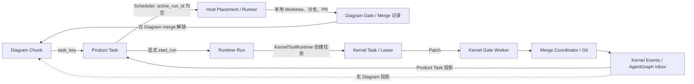
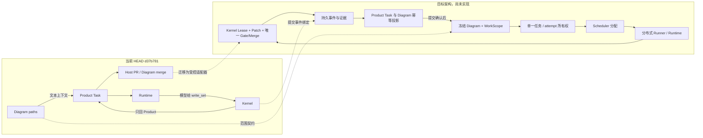

# Phase 0：现状验证与架构盘点

审计基准：本地分支 `production/qualification`，HEAD `d37b7813d865abe50cf2c9e0f5ebb856e36af4de`；审计日期 2026-11-02。仅审计和新增文档，没有修改业务代码。结论分为 **代码已证实**、**测试已执行**、**NOT VERIFIED / UNKNOWN**。规范是目标与审查线索，未作为实现证据。

## 1. 基准、范围与证据边界

用户指定的 `docs/refactor/Veynod_Next_Generation_Architecture_Refactor_Spec_v1.0.md` 在本地不存在；完整阅读的是仓库根目录同名未跟踪文件 `Veynod_Next_Generation_Architecture_Refactor_Spec_v1.0.md`（1851 行）。它自身写明审查基准为 `88626e3`（第 14–20 行），并要求 Phase 0 的五个交付物（第 1341–1369 行）。该文件目前未纳入 Git HEAD，不能算当前产品实现。

`git rev-parse HEAD` 得到 `d37b781`；审计前 `git status --short` 仅显示上述规范为未跟踪文件。`git fetch --no-tags origin 88626e3...` 仅获取对象用于只读 diff，未检出或合并。`git log d37b781...88626e3` 表明规范基准比本地 HEAD 多一个提交：`88626e3 Kernel worktree lease is the default coding path (#88)`。`git diff --stat d37b781 88626e3` 显示 33 文件、2290 插入、128 删除；新增 `AgentGraph/app/services/kernel_delivery.py`、`v3_79_kernel_delivery_leases.sql`、`scripts/smoke_kernel_worktree_gate.py`、`veynod_kernel/tests/test_lease_worktree.py`，并大改 Host Runner、Scheduler 与 Kernel Worktree Pool。**这些能力不属于本报告的当前 HEAD**。当前 HEAD 的最新相关迁移为 AgentGraph `v3_78_event_inbox_nullable.sql`、Runtime `010_lease_epoch.sql`、Kernel `v4_016_runtime_task_key.sql`（各目录文件清单）。

2026-11-02 本轮 `git ls-remote origin refs/heads/main` 返回 `88626e3cda38b9915e277d9a9065efa980b1826f`，因此 GitHub main 不等于本地 HEAD。本轮尝试只读 SSH `deploy@104.207.82.85`，返回 `Permission denied (publickey)`；**VPS 当前源码、镜像 SHA、运行配置和是否为本地 HEAD 均 NOT VERIFIED**。仓库清单 `deploy/vps/docker-compose.unified.yml:35,74,129-133` 只能证明拟部署配置含 `VN_GATE_SANDBOX: local` 与 Runtime Worker 默认 2，不能证明线上实际值。此前会话曾观察 VPS 为 `88626e3`，但没有在本轮重新取得可引用运行证据，不将其当作当前事实。

## 2. 当前真实架构与数据关系

[当前真实架构图](01_CURRENT_ARCHITECTURE.mmd)；[状态所有权矩阵](02_STATE_OWNERSHIP_MATRIX.md)；[执行路径清单](03_EXECUTION_PATH_INVENTORY.md)；[风险登记](04_GAP_AND_RISK_REGISTER.md)。

服务与入口清单：AgentGraph FastAPI 挂 REST、MCP、管理与事件路由（`AgentGraph/app/main.py:357-398`），MCP 暴露 `create_task`、`agent_claim_and_read`、`loop`、`diagram`（`AgentGraph/app/mcp_server/server.py:803-880,1071-1126,2027-2117`），Runner REST 暴露 hello/heartbeat/placements/schedule（`AgentGraph/app/api/v1_routes.py:1476-1621`）；Runtime FastAPI 提供 Run 与事件接口（`agent_runtime/api.py:86-178,348-375`），独立 Worker 通过 `worker_main.py:83-180` 启动；Kernel FastAPI 挂 syscall 与管理路由（`veynod_kernel/app/main.py:5-12`），另有 Gate Worker、Merge Coordinator 和独立 CLI Runner。仓库的 `contracts` 包已有 `IdentityChain`、`attempt_id`、`EventEnvelope` 与 5 个通过的单元测试（`contracts/identifiers.py:15-27,72-77`；`contracts/events.py:58-84`；`contracts/tests/test_contracts.py:21-66`）；对 `AgentGraph/app`、`agent_runtime`、`veynod_kernel/app` 的导入搜索没有发现服务请求路径使用该包，因此不能把包中的统一 ID/事件定义视为跨服务已接线。

Diagram `freeze`/`dispatch` 将 Chunk 建成 `DG-*` Product Task，写 `diagram_chunks.task_key`、`input_context.allowed_write_paths`、`context_slice.write_scope`（`AgentGraph/app/services/diagrams.py:544-657,723-782`）。Product Task 与 Runtime Run 用 `collab_tasks.active_run_id` 关联（`AgentGraph/app/services/task_lifecycle.py:326-344`；`AgentGraph/sql/migrations/v3_75_unified_runtime.sql:16-21`）；Runtime 自己的 `kernel_tasks` 记录 `run_id` 到 Kernel Task（`agent_runtime/migrations/009_kernel_tasks.sql:8-18`；`agent_runtime/tools/kernel.py:438-449`）。Host `runner_placements` 用 Product Task ID/Key 关联（`AgentGraph/sql/migrations/v3_61_runner_placements.sql:13-40`）。`diagram_chunks.task_key` 是普通文本和索引，不是对 Product Task 的强外键（`AgentGraph/sql/migrations/v3_51_diagrams.sql:37-65`）。**没有代码证据证明 Chunk ↔ Kernel Task 一对一、同一执行 attempt 或冻结 WorkScope 的强制绑定。**

当前两个主要执行路径并存：

1. **Diagram → Product Task → Scheduler → Host Runner。** Scheduler 在 `READY`、无 assignee/claim、`active_run_id IS NULL` 时提供 work placement（`scheduler.py:392-497`），还为 Diagram 安排 review/merge step（`scheduler.py:555-812`）。Host Runner 建本地 Git Worktree，调用模型 CLI；提示模型 claim、commit/push、开 PR、调用 Diagram gate/merge（`AgentGraph/cli/bin/runner.mjs:200-257,397-445,623-684`）。Product Lease 在 `tasks.claim_task` 发放（`tasks.py:678-746`）。这条路径没有 Kernel Task、Kernel Lease 或 Kernel Patch 提交的强制步骤。
2. **Product Task `/run` 或 Code Engine → Runtime → Kernel。** API 进入 `task_lifecycle.start_run`（`AgentGraph/app/api/agent_run_routes.py:59-74`；`AgentGraph/app/services/agent_runtime.py:208-231`；`task_lifecycle.py:234-394`）。Runtime Worker 领取 Run、调用 `KernelToolRuntime` 建 Kernel Task、领取 Bundle/Lease、提交 v2 Patch（`agent_runtime/worker.py:46-90`；`agent_runtime/tools/kernel.py:410-585`）。Kernel 校验 Lease 写集与实际 diff，Gate Worker 在 Worktree 验证，Merge Coordinator 执行实际 Git 合并（`veynod_kernel/app/mcp_server/syscalls.py:764-895`；`app/services/verification_gate.py:483-530,1017-1118`；`app/services/merge_coordinator.py:214-352`）。Kernel 事件进入 AgentGraph 持久 inbox 后投影 Product Task（`AgentGraph/app/services/event_dispatch.py:57-165,340-388`）。

此外，`AgentGraph/app/services/code_engine.py:308-350` 保留 `CODE_ENGINE_LEGACY_DIRECT` 的直接 Kernel 路径；Kernel 原生 CLI Runner 独立建 Worktree 并提交 v2 Patch（`veynod_kernel/cli/bin/runner.mjs:465-506,560-675`）；Kernel v1 同步提交开关默认 `reject`，显式 `sync` 才启用（`veynod_kernel/app/config.py:263-269`；`veynod_kernel/app/mcp_server/syscalls.py:990-1023`）。这些入口的生产使用量 **UNKNOWN**。

## 3. 六个关键边界的核实

| 边界 | 当前结论 | 证据 |
|---|---|---|
| 任务所有权 | **分裂**。Scheduler 的选取条件排除活动 Run，但 `start_run` 不检查既有 Host placement/Product Lease，`claim_task` 不检查 `active_run_id`；单个 Runtime Run 约束不能排除 Host claim。并发实际发生次数 UNKNOWN。 | `AgentGraph/app/services/scheduler.py:405-416`；`task_lifecycle.py:234-265,310-344`；`tasks.py:678-746` |
| Write Scope | **未端到端强制**。Diagram 路径进 Product Task 文本上下文；Kernel Task 的 `write_set_symbols` 来自 Runtime 工具参数；Kernel 对自己 Lease 的写集执行有效 diff 边界检查。 | `AgentGraph/app/services/diagrams.py:749-778`；`agent_runtime/tools/kernel.py:417-429`；`veynod_kernel/app/mcp_server/syscalls.py:774-788` |
| Lease | **三个域**：Product Task/Placement Lease、Runtime Run Lease、Kernel Task Lease，各自 fencing/生命周期。未见单一 attempt ID 把三者互斥绑定。 | `AgentGraph/app/services/tasks.py:698-740`、`scheduler.py:362-389`；`agent_runtime/store.py:676-754`；`veynod_kernel/app/mcp_server/syscalls.py:774-788` |
| Gate | **重复**。Diagram Gate/CI 保存调用者报送结果；Kernel Gate 实际在 Worktree 执行验证。二者无共享不可伪造 evidence 引用。 | `AgentGraph/app/services/diagrams.py:850-895,1100-1159`；`veynod_kernel/app/services/verification_gate.py:483-530` |
| Merge | **语义不同**。Diagram `merge` 用传入 artifact 更新 DB 并解锁；Host merge prompt 要求外部 PR squash merge；Kernel Merge Coordinator 才执行受 fence 约束的 Git 合并。 | `AgentGraph/app/services/diagrams.py:1514-1557`；`AgentGraph/cli/bin/runner.mjs:217-226`；`veynod_kernel/app/services/merge_coordinator.py:214-352` |
| 事件回写 | **到 Product Task，未到 Diagram**。Kernel outbox/inbox 有持久化、重试和 dead 状态；Kernel 分支仅 `code_engine.sync_kernel_task_event`，Runtime 分支仅 `task_lifecycle.project_run_event`，没有 Diagram 投影；下游只由 Diagram merge 解锁。 | `veynod_kernel/app/services/event_bus.py:61-75`；`AgentGraph/app/services/event_dispatch.py:340-388`；`AgentGraph/app/services/diagrams.py:1647-1668` |

特别注意 Diagram `submit` 用请求体给的文件名和 commit 计算白名单，支持无仓库的内容摘要（`diagrams.py:941-1005`）；`record_ci` 接受请求体里的 exit code（`diagrams.py:1100-1159`）；`queue_check` 接受请求体里的 pass（`diagrams.py:1466-1512`）；`merge` 接受任意非空 artifact 并将 Chunk 标记 merged（`diagrams.py:1514-1557`）。这证明 Diagram 的记录链不是 Kernel 的可信执行证据。`AgentGraph/tests/test_loop_steps.py:97-118` 使用字符串 `"abc123"` 完成两个 Chunk 的 merge 状态流，测试本身不进行 Kernel/Git 合并。

## 4. 目标架构差异图

下图右侧是规范要求的目标关系，**不是当前实现**；虚线代表 Phase 1 以后才可建立的契约。目标依据规范 `WorkScope` 章节（第 707–752 行）、Kernel 事件与 Diagram 投影章节（第 884–1069 行）、Phase 0/1/2 任务（第 1341–1430 行）。

差异不是增加服务数量，而是补齐跨域不可绕过的身份、写域、执行尝试和提交证据。现有 Kernel fencing、Worktree Gate、持久 outbox/inbox 可复用，见 `veynod_kernel/app/services/gate_worker.py:75-150`、`merge_coordinator.py:214-352`、`event_bus.py:61-75` 与 `AgentGraph/app/services/event_dispatch.py:57-165`。

## 5. 重复实现、状态冲突与安全风险

完整登记和优先级见 [04_GAP_AND_RISK_REGISTER.md](04_GAP_AND_RISK_REGISTER.md)。最关键的可达冲突为：Diagram 标记 `merged` 但 Kernel 未 COMMITTED，或 Kernel 已 COMMITTED 而 Diagram 仍 `dispatched`，因为二者没有投影联结（`diagrams.py:1533-1555`；`event_dispatch.py:340-360`）。Diagram 允许空写入路径，文件锁检查直接放行空集合（`diagrams.py:100-139,664-683`）；Host 路径依赖模型遵守分支/PR 提示（`AgentGraph/cli/bin/runner.mjs:247-257`）。部署清单将 Gate Sandbox 设为 `local`，仅靠环境净化而非容器隔离（`deploy/vps/docker-compose.unified.yml:35,74`；`veynod_kernel/app/services/gate_sandbox.py:59-75,115-132,275-284`）；实际线上值未验证。

## 6. 本轮测试基线与不能证明的事项

| 层级 | 执行命令 / 结果 | 解释 |
|---|---|---|
| Kernel 单元/组件 | `python -m pytest -q veynod_kernel/tests/test_submission_protocol_unit.py veynod_kernel/tests/test_merge_coordinator.py veynod_kernel/tests/test_security_config.py`：15 passed | 覆盖提交键/环境净化、merge fence、Git/DB 崩溃协调等；不是全链路容量验证。 |
| 跨域契约单元 | `python -m pytest -q contracts/tests/test_contracts.py`：5 passed | 只验证契约对象自身；服务请求路径未见接线。 |
| Runtime 选定测试 | `python -m pytest -q agent_runtime/tests/test_kernel_tool.py agent_runtime/tests/test_fencing.py agent_runtime/tests/test_multi_kernel_events.py`：2 passed，16 skipped | 多数依赖外部条件，不能证明跨服务链路。 |
| Diagram 集成 | `python -m pytest -q AgentGraph/tests/test_diagrams.py AgentGraph/tests/test_loop_steps.py`：25 skipped | 本机未具备所需测试数据库条件；代码内的 fake artifact 仍可作为测试意图证据。 |
| Host Runner Node | `node --test AgentGraph/cli/test/runner.test.mjs`：22 tests，19 passed，3 failed | 失败点分别是 Codex CLI 探测预期、Windows CRLF、Windows scratch 路径转义；不能称 Runner 测试通过。 |

本轮没有运行整个仓库测试、真实多 Runner E2E、真实 Diagram→Kernel→Diagram 测试或 1000 并发压测。`scripts/capacity_unified.py:1-13` 有分级脚本；`docs/UNIFIED_ACCEPTANCE_REPORT.md:248` 自述未重测 1000 Runner 且历史 P99 54 秒为 FAIL。**1000 个已建任务与 1000 个同时活跃执行者不是同一指标**，本报告对企业 1000 Agent 目标的当前可胜任性判定为 **NOT VERIFIED，现有已确认 P0 断层阻止直接按目标架构使用**。

## 7. 按依赖排序的最小重构任务清单（待审核，不在 Phase 0 实施）

1. **选定实施基准并补齐运行证据。** 决定以 `d37b781` 还是已在 GitHub 的 `88626e3` 为下一阶段代码基准；获取 VPS 镜像 digest、迁移版本、关键环境开关。依赖：无；验证：Git SHA、镜像 digest、数据库迁移 ledger 与只读配置输出。此步必须先于任务设计，因为 `88626e3` 已改变 Host 执行路径。
2. **定义统一关联与 WorkScope 契约。** 固化 `diagram_id/chunk_id/product_task_id/attempt_id/run_id/kernel_task_id`、范围版本/哈希、路径规范化、空范围规则与不可变状态；迁移旧记录时显式标记未知。依赖 1；验证：契约测试、拒绝扩大写集的负面测试。对应 G01/G05。
3. **建立单一活动 attempt 所有权。** 在 Product Task 上用原子占有/释放覆盖 Scheduler placement、Host claim、`start_run` 与取消/超时，保留 fencing；旧入口必须遵守同一 CAS。依赖 2；验证：并发抢占、重试、断线恢复测试。对应 G02。
4. **打通 Diagram→Kernel 写域与执行链。** 将冻结 WorkScope 经服务端传到 Kernel Task/Lease，Kernel 校验每个 Patch/文件；Host Runner 通过 Kernel 协议执行，旧 PR 路径作为显式受控迁移适配器。依赖 2、3；验证：真实 Worktree 越权 diff 拒绝与多 Runner 同域冲突测试。对应 G01/G06。
5. **统一 Gate/Merge 所有权与事件投影。** 只以 Kernel 持久 Gate/commit evidence 作为代码完成事实，Diagram 的旧 gate/merge 改为只读或受控映射；建立幂等 Kernel event→Product/Diagram 投影，提交后解锁下游、可重放与对账。依赖 3、4；验证：重复事件、乱序、Git-first/DB-first 崩溃、旧入口并发测试。对应 G03/G04。
6. **加强 Gate 隔离和分级容量验收。** 使用受限执行环境，验证文件/网络/资源隔离；按 10、50、100、250、500、1000 真实多 Runner 分级运行，并区分已建、已领取、活跃推理、活跃写入、Gate 队列和已提交。依赖 4、5；验证：安全负面测试、故障注入、P95/P99、吞吐、排队、恢复和成本报告。对应 G07/G08/G11。

本清单是 **Phase 0 建议**。Phase 1 未启动；须先审核本报告和代码基准选择。
