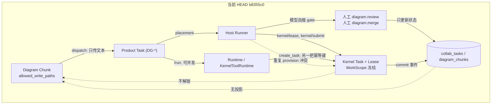

# Phase 0：当前状态核验（HEAD `b8355c0`）

审计时间：2026-11-02。审计对象：本地 `codex/phase2-diagram-kernel` HEAD `b8355c0`（含 Phase 0、Phase 1 两个提交）。
方式：逐条读调用链 + 真实进程/数据库探针；不改业务代码。

**证据分级**：`[代码]` 已读实代码；`[测试]` 已执行；`[运行]` 真实进程/数据库实测；
`[未验证]` 无证据，不猜测；`[与既有文档冲突]` 既有 Phase 0/1 报告与本轮实测不一致。

**相对规范的基准**：规范自身写明基准 `88626e3`。当前 HEAD 是它的后代（+`c1130f6`、+`b8355c0`），
规范 §0 要求"以代码与可复现结果为准，并列出差异"。差异见 §1。

> 本文取代 `c1130f6` 版本的 Phase 0 报告。那份报告的基准是 `d37b781`，**早于** `88626e3`
> 的 Host→Kernel 路径改造，其"当前 HEAD/迁移版本"章节已过期 `[与既有文档冲突]`。

---

## 0. 结论摘要

**Diagram 与 Kernel 至今没有接上**，这是本阶段最大的断层：

* `AgentGraph/app/services/diagrams.py` 全文 **零次**出现 `kernel`（`grep -n kernel` 无输出）`[代码]`。
* 派发创建的 chunk 任务走 `_create_task_core(..., commit=False)`（`diagrams.py:765`），
  绕过 `create_task()` 里的自动 provision（`tasks.py:517-521`）`[代码]`。
* 因此 Diagram chunk **不会创建 Kernel 任务、不会拿 Kernel lease**，交付仍靠
  "模型自己开 PR + 人工 `diagram(action=merge)`" `[代码]`。

而 Phase 1 建立的 WorkScope 只在 **非 Diagram 路径**（`/v1/tasks/{key}/run` → Runtime、
或 `POST /v1/tasks` 建带 repo 的任务 → 自动 provision）上生效。两条路径互不相交。

更严重的是这两条路径**互相抢同一份工作**，且有一个新引入的重复 provision 直接让第二个 Kernel
任务领不到租约（§2.3，实测）。

---

## 1. 与规范基准的差异（`88626e3` → HEAD）

| 提交 | 内容 | 对本次审计的影响 |
|---|---|---|
| `88626e3` | #88 "Kernel worktree lease is the default coding path"：新增 `kernel_delivery.py`(691)、`v3_79_kernel_delivery_leases.sql`、runner 改走 `/kernel/lease`+`/kernel/submit`、scheduler 跳过 kernel-owned 的 review/merge | 引入第三条交付路径（Host→Kernel），且**只对 Host 生效** |
| `d1bde6f` | #87 inbox SSE 抗断连、`deploy/proxy/*` | 与交付链无关 |
| `c1130f6` | Phase 0 文档 | 审计基准 `d37b781`，早于 `88626e3`，当前状态章节已过期 |
| `b8355c0` | Phase 1：`contracts/work_scope.py`、`v4_017_work_scope.sql`、Kernel 双层 diff 校验、`task_lifecycle` 传 scope | WorkScope 只在 runtime/runtime-task 链上接线 |

旧报告称"当前 HEAD 最新迁移为 v3_78 / 010 / v4_016"，实际现在是 **v3_79 / 010 / v4_017** `[代码]`。

---

## 2. 逐项核实

### 2.1 Diagram Chunk 的真实数据关系

`[代码]` `diagrams.py:723-782` 建任务时写入 `task_key = DG-<diagram>-<chunk>`（`:723`）、
`input_context.diagram/chunk/allowed_write_paths/...`（`:748-757`），并回填
`diagram_chunks.task_key`（`:654`）。

`[代码]` `diagram_chunks.task_key` 是 `TEXT` + 索引，**无外键**；删除任务不级联。

`[代码]` 派发后 chunk 状态只能是 `dispatched` / `blocked`（`:642`、`:652`）。

**没有** `chunk → kernel_task_id` 字段；Kernel 侧也**没有** `chunk_id` 列（`v4_017` 只加
`work_scope/scope_hash/lease_scope*`）。

### 2.2 交付链：三条并存

| # | 入口 | 执行者 | 有 Kernel? | WriteScope? | 谁判定通过 | 谁写 Git |
|---|---|---|---|---|---|---|
| A | Diagram `dispatch` → Host placement | `runner.mjs` 起模型 CLI | 否 | 否（仅文本上下文） | 模型自报 `diagram.review` + 人 `merge` | 外部 PR squash merge |
| B | `POST /v1/tasks`（带 repo）→ 自动 provision → Host `/kernel/lease` | `runner.mjs` 写代码 | 是 | 是 | Kernel Gate + MergeCoordinator | Kernel |
| C | `POST /v1/tasks/{key}/run` → Runtime → `KernelToolRuntime.create_task` | Runtime Worker | 是 | 是 | Kernel Gate + MergeCoordinator | Kernel |

`[代码]` A 的判定完全在 AgentGraph：`gate()` 取 `body["result"]`（`diagrams.py:853`）、
`record_ci()` 取 `body["exit_code"]`（`:1100`）、`merge()` 接受任意 `artifact` 字符串（`:1537`）。
`[代码]` B/C 的判定在 Kernel：`verification_gate` 跑 5 阶段，`merge_coordinator` 做 CAS 合并。

`[代码]` A 的解锁只由 `merge()` 末尾 `_release_waiting()` 触发（`:1553`）；
`_release_waiting` 全仓库只有这一个调用点（定义 `:1647`）。

### 2.3 B 与 C 对同一任务重复 provision（**新增 P0，实测**）

`[代码]` 两处 provision 用**不同的幂等键**：

* `kernel_delivery.provision_product_task` → `request_key = "product:<task_key>"`（`:504`）
* `KernelToolRuntime._do_create_task` → `request_key = "<task_key>:<model tool key>"`（`tools/kernel.py:419`）

`[运行]` 真实 Kernel（临时库 `veynod_probe` + 真 git 仓库）复现：

```
host create: 201
host lease:  200 leased=True          # 节点 1 已被 host 租走
runtime create: 201 same task? False  # 节点 2 新建
runtime pull(any): 200 leased=False
k tasks: [('71664752','LEASED'), ('55f98b1b','READY')]
targeted pull on 2nd: leased=False    # 定向也拿不到
```

原因：`pull_task_bundle` 的 SQL 要求 `NOT (t.write_locks && active_w)`（`scheduler.py:646`），
两个节点写集相同，节点 1 处于 `LEASED`，节点 2 永远冲突；Runtime 工具租不到就 `pause`，Run 停住。

**结论**：任何带 repo 的任务一旦被自动 provision（默认
`kernel_provision_on_create = True`，`config.py:118`）又走 `POST /run`，
会产生一个永远领不到租约的孤儿 Kernel 任务。

### 2.4 任务所有权：Product Task 的两种认领互不互斥

`[代码]` Host 侧 `claim_task`（`tasks.py:678-746`）检查 role/capabilities/assignee，
**不检查 `active_run_id`**。
`[代码]` Scheduler 排任务时排除 `active_run_id IS NOT NULL`（`scheduler.py:413`），
只影响"新放置"，不影响已在 host 上的 claimed 任务。
`[代码]` Runtime 侧 `start_run`（`task_lifecycle.py:265`）**不检查** `claimed_by` /
`lease_owner` / 已有 `kernel_delivery`。

于是：Host 已 claim 并持 lease → 再 `POST /run` → Runtime 也跑同一任务，
产物分别是"Host 的 PR + 模型自报 gate"和"Kernel 的 commit"，互不感知。

### 2.5 Kernel lease 没有客户端侧过期判断，且 release 不留 Kernel

`[代码]` `open_lease` 复用租约只看 `lease == "held"` + 有 `kernel_task_id` + 有 token
（`kernel_delivery.py:589-596`），**不看 `expires_at`**；`expires_at` 只写不读（`:399`）。
过期租约被当有效继续用，直到 submit 时 Kernel 409。

`[代码]` `release_task`（`tasks.py:869`）改回 READY 并 `_clear_lease()`，
**不调用任何 Kernel release**；`kernel_delivery.py` 没有 release 函数（`grep release` 0 命中）。
Host 释放后 Kernel 节点仍 `LEASED` 到超时，期间同写集全部冲突。
`[代码]` `_take_back`（`scheduler.py:154`，掉线/超时）同样只 orphan Product lease。

### 2.6 WorkScope 确实传到 Kernel，但**只对 B 生效**

`[代码]` `task_lifecycle.start_run`（`:269`）与 `kernel_delivery.work_scope_for`（`:68-80`）
从 `input_context.diagram + allowed_write_paths` 生成 scope；Kernel 用 `v4_017` 触发器
冻结 `work_scope`，`syscalls._validate_submission` 与 `verification_gate._check_ast_scope`
（`:765-800`）双层校验。`[测试]` 该链 19+11+4 通过、1 个真实 Worktree 集成测试通过（Phase 1 报告）。

**但** `[代码]` `diagrams.py` 从不调 `kernel_delivery`，chunk 走 A 链，所以
`allowed_write_paths` 在 A 链上只用于 `diagram.submit` 的文件名 fnmatch（`:946-948`），没进 Kernel。

空写集另有一处相反规则 `[运行]`：

```
work_scope_for(empty) → {"paths": {"include": [], "exclude": []}}
WorkScope.from_dict(...) → ValueError: WorkScope requires a nonempty paths.include
```

`[代码]` `_incomplete()`（`:133-139`）只要求 `icd` 与 `done_criteria`，**不要求**
`allowed_write_paths`；`_lock_conflicts` 空集合直接 `return []`（`:667-668`）。
合法 chunk 因此可派发，再在 Kernel 侧 422。

### 2.7 Gate / Merge 的重复权威

| 事实 | 位置 |
|---|---|
| A 链 gate 由调用者自报 | `diagrams.py:853-877` `[代码]` |
| A 链 merge 只更新 DB 行并解锁 | `diagrams.py:1537-1555` `[代码]` |
| B/C 链 merge 由 Kernel 做 Git CAS | `merge_coordinator.py:214-352` `[代码]` |
| Kernel commit 事件**只**投影 Product Task，不投影 Diagram | `event_dispatch.py:340-350`；`task_lifecycle.py` 全文无 `diagram` `[代码]` |
| Diagram 后继解锁**只**认 `state = merged` | `_waiting_on` `diagrams.py:615-620` `[代码]` |

即使 B 链已把代码合进 Git，Diagram 仍 `dispatched`、下游永不解锁，除非有人再手工 merge，
那又会在已合并仓库上再解一次锁。

### 2.8 Scheduler 的 review/merge 跳过只覆盖一半（**导致现成测试失败**）

`[代码]` `_place_steps` 用 `kernel_owns_steps(task)` 跳过 review/merge（`scheduler.py:747-752`），
该函数读 `correlation.kernel_delivery.status`（`kernel_delivery.py:137-146`）。
`[代码]` 但写集为空时 provision 写的是 `status="needs_write_set"`（`:494-498`），
`_NOT_WIRED` 只有 `{"", "legacy", "unbound", "unconfigured"}`（`:37`）——**不含**它。

`[运行]`：

```
FAILED tests/test_loop_steps.py::test_a_plain_task_in_review_goes_to_a_reviewer_and_moves_when_it_stalls
FAILED tests/test_loop_steps.py::test_no_reviewer_is_said_in_plain_words
2 failed, 23 passed
```

带 repo 的任务在 `create_task` 时自动 provision，没有 `write_set_symbols` 就落 `needs_write_set`，
review/merge 被永久跳过，而它其实一个 Kernel 节点都还没建出来。

### 2.9 Host Runner 的 `touched_symbols` 是噪音

`[代码]` `runner.mjs:944` 传 `touched_symbols: leaseBook.get(slot)?.write_set || ["lease"]`，
即租约写集本身而不是本次 diff 触及的符号；`_validate_submission`（`syscalls.py:774-788`）
用它做 AST 越权检查，对 Host 路径几乎恒真；真正兜底的是
`verification_gate._check_ast_scope`（`[代码]`）。不是漏洞，但提交层自证失效。

### 2.10 生产落后 HEAD，且缺 Phase 1 的列

`[运行]` VPS `VEYNOD_TAG=88626e3`；Kernel 库 `v4_014`；`dag_tasks` 上
`work_scope/scope_hash` 计数 = **0**；产品库有 **63** 个 `diagram_chunks`。
线上既无 WorkScope 链也无 Phase 2 代码。`[未验证]` 那 63 个 chunk 当前如何推进。

---

## 3. 架构断层图



| 目标（规范 §5.3/§13/§19） | 当前 |
|---|---|
| Chunk 1:1 绑定唯一 Kernel Task | 无字段、无约束、无代码 |
| Chunk 合并由 Kernel Commit 事件投影 | 无投影，`_waiting_on` 只认人工 `merged` |
| 一个 Attempt 一个 Lease，旧 Lease 被 fence | 无 `attempt_id`；Host 与 Runtime 各有自己的 lease |
| 旧 Diagram gate/merge 对 Kernel-owned chunk 拒绝 | 未实现 |
| 无证据不推进 | A 链靠自报；B 链有证据但不回图 |

---

## 4. 缺陷登记

修复状态见文末 §7。下表是审计时的原始登记。

| ID | 级别 | 缺陷 | 证据 |
|---|---|---|---|
| G01 | **P0** | Diagram chunk 完全绕过 Kernel，写域只在文本上下文 | §2.1/§2.2/§2.6 `[代码]` |
| G02 | **P0** | Host 自动 provision 与 Runtime `create_task` 键不同，第二个节点写集冲突 | §2.3 `[运行]` |
| G03 | **P0** | Review/merge 放置被 `needs_write_set` 误判 Kernel-owned 而跳过 | §2.8 `[代码]+[运行]` |
| G04 | **P1** | Kernel commit 不投影 Diagram，下游只由人工 merge 解锁 | §2.7 `[代码]` |
| G05 | **P1** | Product Task 可被 Host claim 与 Runtime Run 同时持有 | §2.4 `[代码]` |
| G06 | **P1** | Kernel lease 无过期判断；release/orphan 不释放 Kernel 租约 | §2.5 `[代码]` |
| G07 | **P1** | 空 `allowed_write_paths` 可派发但 Kernel 拒绝，规则相反 | §2.6 `[运行]` |
| G08 | P2 | 无 `chunk_id` 关联列；`diagram_chunks.task_key` 无外键 | §2.1 `[代码]` |
| G09 | P2 | Host `touched_symbols` 恒等于写集，提交层自证失效 | §2.9 `[代码]` |
| G10 | P2 | 生产落后 HEAD 且缺 `v4_017` 列 | §2.10 `[运行]` |

---

## 5. 测试基线（本轮实跑）

| 命令 | 结果 |
|---|---|
| `pytest contracts/tests agent_runtime/tests veynod_kernel/tests/test_work_scope_boundary.py veynod_kernel/tests/test_submission_protocol_unit.py -q` | **36 passed, 42 skipped** |
| `pytest AgentGraph/tests/test_diagrams.py AgentGraph/tests/test_loop_steps.py -q` | **23 passed, 2 failed**（失败即 G03） |
| 真实 Kernel 探针（临时库 + 真 git） | 复现 G02 |

`[代码]` 没有测试同时走"派发 → Kernel lease → Kernel commit → Diagram 解锁"；
`grep 'kernel/lease' AgentGraph/tests/*.py` = **0 命中**。

---

## 6. 最小重构任务清单（按依赖排序）

1. **G02**：runtime 与 host 共用 `request_key = product:<task_key>`，或 `start_run`
   先复用 `correlation.kernel_delivery`。验证：同一任务两次 provision 只有一个 Kernel 任务（把探针转成测试）。
2. **G03**：`needs_write_set` 归入 `_NOT_WIRED`，或只在真正拿到 lease 后才算 owned。验证：`test_loop_steps` 恢复全绿。
3. **G07**：`_incomplete()` 要求非空 `allowed_write_paths`；空集合时 `work_scope_for` 返回 None 走旧写集。验证：空路径 chunk 可派发也可提交。
4. **G08**：加 `diagram_chunks.kernel_task_id` + 唯一约束，配合 `v4_017` 的 scope 冻结形成 1:1。验证：同 chunk 二次 provision 409。
5. **G01**：`dispatch` 调 `provision_product_task`，失败即不派发。验证：真实 chunk → Kernel lease 集成测试。
6. **G04**：commit 事件写 `chunk.state=merged` 并调 `_release_waiting`，幂等键 `(chunk_id, commit_sha)`；人工 merge 对 Kernel-owned chunk 改为校验。验证：重复事件不重复解锁。
7. **G05**：`claim_task` 拒绝有 `active_run_id` 的任务，`start_run` 拒绝有 `claimed_by` 的任务。验证：双向并发抢占测试。
8. **G06**：`open_lease` 比对 `expires_at`；release/orphan 调 Kernel release。验证：过期触发重领、释放后可再租。
9. **G10**：部署 HEAD 并应用 `v4_017`；核对 63 个历史 chunk。

1–3 可并行，4–6 必须按序，7–8 依赖 1/4，9 最后。


---

## 7. 修复状态（2026-11-02，同分支）

G01–G07、G09 与 G06 已修复，**未提交**，细节见 [HANDOFF.md](HANDOFF.md)。

| ID | 状态 | 修复要点 |
|---|---|---|
| G01 | 已修 | `dispatch` 绑定 Kernel 节点（`lease=False`），失败写 `CHUNK_KERNEL_UNBOUND` |
| G02 | 已修 | runtime 与 host 共用 `request_key = product:<task_key>`；实测 1 个节点、第二次复用 |
| G03 | 已修 | `needs_write_set`/`lease_denied`/`admission` 不再算 Kernel-owned；`test_loop_steps` 恢复全绿 |
| G04 | 已修 | `project_kernel_commit` 投影 merged + 解锁，`(chunk, commit)` 去重；人工 merge 降级为校验 |
| G05 | 已修 | `claim_task` 拒 `active_run_id`；`start_run` 拒已 claim 的 IN_PROGRESS |
| G06 | 已修 | `open_lease` 拒过期租约；`release_task`/`_take_back` 释放 Kernel 租约 |
| G07 | 已修 | 空写路径在 `_incomplete` 拦截，`work_scope_for` 空集合回落 legacy |
| G08 | 已修 | 迁移 `v3_80`：`kernel_task_id` 等列、唯一索引、投影去重表、scope 约束 |
| G09 | 已修 | runner 从 diff 解析真实 `touched_symbols` |
| G10 | **未修** | 生产仍是 `88626e3`，缺 `v4_017`/`v3_80` |
| G11 | 部分 | 本文已按 HEAD 重写；`01/02/03/04` 附属文档仍是旧基准 |

验证：`test_diagrams`/`test_loop_steps`/`test_kernel_delivery_scope`/`test_task_lifecycle` = 38 passed；
kernel 安全/守卫/scope 子集 = 9 passed；真实探针见 HANDOFF §3。全量回归见 §8。

---

## 8. 后续一轮（同分支，仍未提交）

在上面 9 项之外，`docs/veynod_im.md` 与 `phase-2/PLAN.md` 的剩余项也已落地：

| 项 | 状态 | 说明 |
|---|---|---|
| Phase 2 端到端 | 已过 | `test_phase2_chunk_delivery.py` 3 passed：真实 Kernel + gate worker + bare 仓库，冻结→派发绑定→lease→五阶段门禁→commit→chunk merged→下游解锁；重复事件与对账都不重复合并 |
| Phase 2 对账器 | 已做 | `diagram_reconcile.py`，以 Kernel evidence 为准补投投影 |
| G01 投影缺 `doc_key` | 已修 | `project_kernel_commit` 的 `_event` 会 KeyError；查询与 dict 都补了 |
| nerve 通道 | 已做 | `contracts/nerve_protocol.py`、`nerve_hub.py`、`/v1/ws/nerve`、`veynod-messenger.mjs`、`v3_81`；200 ms / 5000 ms 双勾，17 个测试 |
| 状态写入收敛 | 已做 | `transition_task_fenced` / `end_task_lease_fenced`（epoch CAS） |
| 后台循环剥离 | 已做 | `ENABLE_INLINE_BACKGROUND_LOOPS` + `app/worker.py` |

细节与偏离见 [IM_IMPLEMENTATION.md](IM_IMPLEMENTATION.md)、[phase-2/RESULT.md](phase-2/RESULT.md)。

G10 仍是唯一的未修项：生产没有这些迁移与代码。

