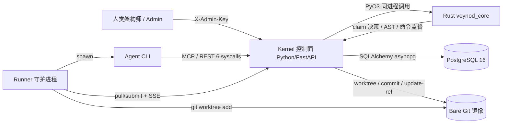
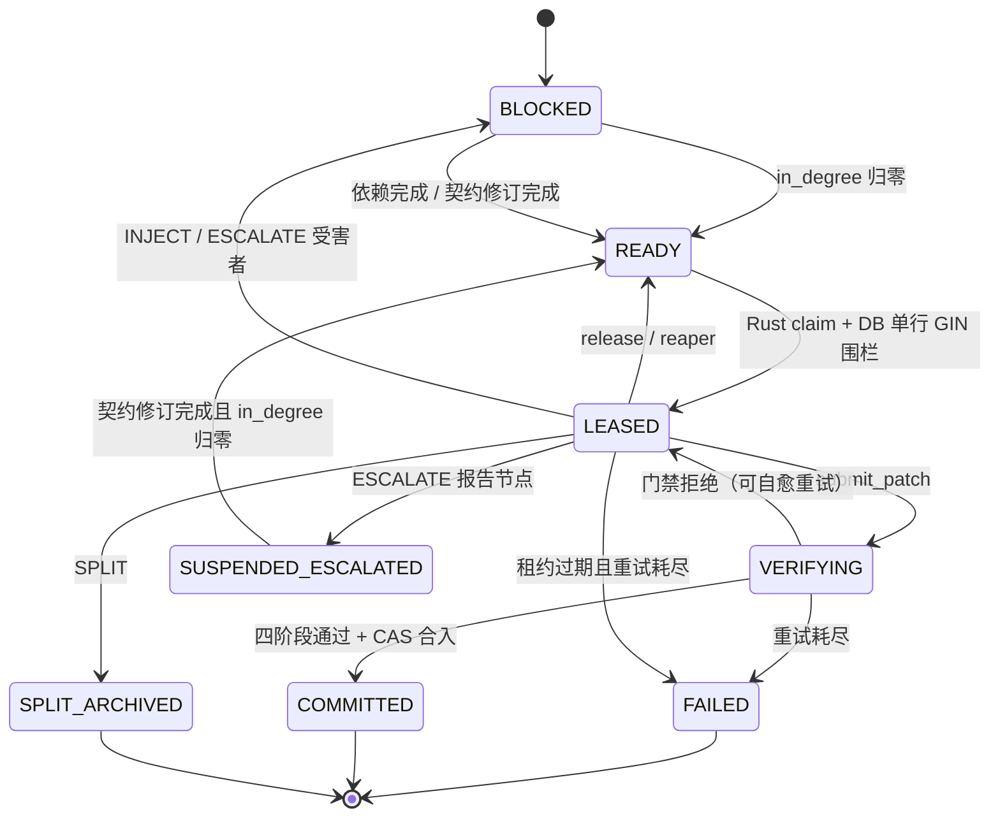

# Veynod Kernel v4.0 — 架构设计说明

> **文档目的：** 面向架构师/技术负责人做架构评审、容量评估与后续演进决策。  
> **代码根目录：** `E:\Codes\veynod`  
> **文档版本：** 2026-10-31，对应当前仓库状态  
> **结论先行：** 这是一个 **Python 控制面 + Rust 权威计算核心（PyO3 同进程扩展）+ PostgreSQL 持久化/ACID 围栏 + Git 主干 + 无状态 Runner** 的混血架构。三条核心（AST、锁代数/图调度、门禁执行器调度）在 Rust；Python 负责 API/MCP、鉴权、事务、高层状态机与 Git 编排。

---

## 0. 一页结论（给评审会的第一屏）

### 0.1 它解决什么问题

面向“单人驾驭大量 Agent 开发大型代码库”的场景：

- Agent 上下文容易爆炸 → **AST 切片**只给 1-hop 签名、stub、冻结测试，不给全仓库。
- 多 Agent 并行改代码必然冲突 → **层级写集锁** + **Rust 内存调度器**保证同时 LEASED 的任务写集正交。
- 接口漂移、幻觉改签名 → **契约冻结 + AST 签名哈希守恒**，改签名必须走 `escalate_contract_defect`。
- 人工 Code Review 不可扩展 → **四阶段确定性门禁**（写集边界、契约哈希、类型/Lint、测试）+ Git CAS 原子合入。
- 合并冲突地狱 → **Git worktree 沙箱 + update-ref CAS + 单行 GIN 校验**。

### 0.2 关键架构赌注

| 赌注 | 选择 | 代价/收益 |
| :--- | :--- | :--- |
| 控制面语言 | Python / FastAPI | 开发快、契约改动成本低；性能热点全部下沉 Rust |
| 计算核心 | Rust / PyO3 同进程扩展 | 零网络跳数、部署简单；单进程内权威，多 kernel 共享需未来 sidecar |
| 调度真相 | Rust 内存图做决策；Postgres 做持久化与 ACID 围栏 | 兼顾 1M 内存调度与崩溃恢复/多进程安全 |
| 门禁裁决 | 确定性工具链，不做 LLM Review | 可重复、可审计；需要 pyright/ruff/pytest |
| 代码合并 | bare Git + worktree + `update-ref` CAS | 线性、无冲突；仓库必须是 bare mirror |
| 门禁执行 | Rust supervisor 调度 pyright/ruff/pytest | 超时/进程树/输出上限；不是 OS 级安全沙箱 |

### 0.3 已验证的规模与质量

- **1M 节点调度核心**：`cargo test --release million_node_claim -- --ignored`  
  - 1M tasks upsert：**~4.43 s**
  - 1,000 次 claim：**~5.1 ms**（单次约 5 µs）
  - 状态：`(1,000,000 tasks, 999,000 ready, 1,000 active)`
- **63 个 Python 测试**（Rust 权威路径与 `VEYNOD_DISABLE_RUST=1` 纯 Python 回退各跑一轮）
- **第二轮 100 Runner**：merge 临界区 p50 **218–281 ms**（上一版 550–620 ms）；claim 决策 p95 **3.17 s → 358 ms**；`gate_pool_wait` p50 **20.2 s** 是 submit 的主瓶颈
- **14 个 Rust 单元测试** + 1 个 ignored 1M 规模测试
- **100 Runner 压测**：见 [STRESS_TEST.md](STRESS_TEST.md)
- **3 个真实端到端冒烟**：API、Node Runner、scan-stubs 红灯→实现→绿灯
- `ruff` 全绿、`pyright app` 0 error

---

## 1. 系统定位与非目标

### 1.1 定位

Veynod Kernel 是 Agent 与 Git 主干之间的 **确定性任务编排器 + 合并裁判**：

```text
人类架构师
   │ 写 spec / 播种任务 / 看板 / 处理契约上诉
   ▼
Kernel（Python 控制面 + Rust 核心）
   │ 6 个系统调用（REST + MCP）
   ▼
Runner（无状态守护进程，Git worktree 沙箱）
   │ 启动 Claude Code / Codex / 自研 Agent
   ▼
Agent 只看到 AST 切片后的 bundle，只改 write_set 内文件
```

### 1.2 四条工程公理（对应设计取舍）

1. **信息隐藏**：Worker 上下文严格 ≤ `max_context_tokens`（默认 6,000），只含签名、stub、冻结测试与历史门禁报错。
2. **契约先行 + 单向冻结**：`DESIGN_CONTRACT → WRITE_TEST → IMPLEMENT_BODY`；下游执行时上游签名/测试只读。
3. **写集正交**：同一时刻 LEASED/VERIFYING 的任务在 AST 符号树上不相交；由 Rust 内存图 + Postgres GIN 双重保证。
4. **确定性门禁**：写集越权、契约哈希变化、类型/Lint 错误、测试失败，任一即拒绝；没有 LLM 主观评分。

### 1.3 非目标

- 不是 IDE / 代码生成器；Agent 负责写实现，Kernel 只做约束与裁决。
- 不是通用 CI；它围绕“契约、写集、租约、DAG”设计。
- 不提供 OS 级安全隔离；门禁会执行 Agent 提交的测试代码，生产必须容器/VM 化。
- 不做多租户 SaaS；默认单 workspace（syscall 协议不带 workspace_id）。

---

## 2. 运行时拓扑



### 2.1 进程与部署单元

| 单元 | 数量 | 状态 | 说明 |
| :--- | :--- | :--- | :--- |
| Kernel API（uvicorn） | 1（推荐） | 有状态（Rust 内存图） | 也可多进程，但 Rust 内存图按进程隔离；多进程靠 DB 围栏兜底 |
| Rust 扩展 `veynod_core` | 每 Kernel 进程 1 个 `.pyd/.so` | 进程内库 | abi3-py310 wheel；无网络调用 |
| PostgreSQL 16 | 1 主库 | 持久化 | 任务/制品/事件/Token/GIN 索引 |
| Bare Git 仓库 | 1 | 源码真相 | 门禁 `update-ref` 推进 main；Runner 创建 worktree |
| Runner | N | 无状态 | 每个 Runner 建议独立 token；可跨机 |
| Agent | N | 无状态 | Claude Code / Codex / 自研；只挂 6 个原语 |

### 2.2 关键进程内对象

- `PostgresKernelEngineService`：每个 HTTP 请求构造一个，绑定请求级 `AsyncSession`；实现 7 个引擎方法（6 原语 + 租约校验）。
- `SchedulerCoreManager`：进程级单例，持有 Rust `SchedulerCore`；负责 workspace 快照加载、增量同步、claim/revert。
- `DisjointWriteSetScheduler`：请求级；Rust 内存决策后，单 Kernel 默认直接条件 UPDATE + GIN 围栏，多进程模式才持 per-workspace advisory lock 再持久化租约。
- `DeterministicVerificationGate`：请求级；编排 Git/门禁/合并，命令执行交给 Rust supervisor。

---

## 3. 职责边界

### 3.1 Python 控制面（保留）

负责：

- HTTP / MCP 路由、Pydantic 契约、鉴权（Runner `vnk_` token、Admin `X-Admin-Key`）。
- 请求级事务、DB 读写、任务/制品状态机的**编排**。
- Git worktree/apply/commit/update-ref 的编排（不是底层命令调度）。
- SSE 事件流、Dashboard、Admin 面、Runner 面。
- **不负责**：锁冲突判定、调度候选选择、AST 解析、pyright/ruff/pytest 的进程级执行调度。

### 3.2 Rust 核心（`veynod_core`）

| Rust 模块 | 职责 | 为什么在 Rust |
| :--- | :--- | :--- |
| `locks.rs` | 路径规范化、write/ancestor 展开、子集/覆盖/冲突、新文件提升 | 纯字符串/集合热点，Python 循环成本高 |
| `scheduler_core.rs` | 权威内存图、锁索引、blocked 计数、READY 优先队列、claim/revert | 1M 节点、O(log N)/轻量锁、无 per-task 锁 |
| `ast.rs` | tree-sitter 解析、签名骨架、SHA-256、stub、引用名、解析树缓存 | 零成本抽象、低内存、按文件缓存 |
| `sandbox.rs` | pyright/ruff/pytest 的超时、进程组/taskkill 终止、输出上限 | 可靠的进程树管理，避免 Python 子进程泄漏 |

### 3.3 PostgreSQL（持久化 + ACID 围栏）

- 任务、制品、依赖边、符号边、事件游标、Runner token。
- GIN 索引支撑写集重叠查询；`lease_token_hash` 唯一。
- **不是调度决策者**：Rust 先选任务，Postgres 用单行 `NOT EXISTS` 复核并条件 UPDATE。
- 多进程/崩溃恢复的真相源。

### 3.4 Git

- bare mirror 是代码真相；门禁用 detached worktree 验证，`update-ref <new> <old>` CAS 推进 main。
- Runner 也用 worktree 隔离每个任务；Agent 禁止 commit/push。
- 仓库必须是 bare，或 main 未在其他 worktree 检出；否则普通工作区会与 HEAD 脱节。

### 3.5 Runner / Agent

- Runner：拉任务、worktree、启动 Agent、本地写集守卫、本地预检、submit、SSE 抢占。
- Agent：只看到 bundle；可调用 `pull_task_bundle` 之外的 5 个原语（实际由 Runner 管理生命周期）。
- 本地预检：
  - `WRITE_TEST`：只 collect（允许红灯）
  - `IMPLEMENT_BODY` / `FIX_INTEGRATION`：只跑关联测试文件
  - `DESIGN_CONTRACT` / `REVISE_CONTRACT` / `DESIGN_ARCHITECTURE`：跳过运行时测试，由门禁类型/Lint 检查

---

## 4. 数据模型

### 4.1 表

| 表 | 关键字段 | 作用 |
| :--- | :--- | :--- |
| `workspaces` | `repo_path`, `main_branch`, `head_commit_sha` | 项目与 Git HEAD |
| `code_artifacts` | `file_path`, `symbol_path`, `kind`, `status`, `ast_signature`, `signature_hash`, `content_hash`, `version` | 双偶图节点 A：契约/stub/实现/测试 |
| `dag_tasks` | `type`, `status`, `priority`, `in_degree`, read/target/test artifact ids, `write_locks`, `ancestor_locks`, lease fields, `base_commit_sha`, `result_commit_sha`, retry/error | 双偶图节点 B：任务 |
| `task_dependencies` | upstream/downstream | 拓扑依赖 |
| `symbol_edges` | caller/callee, `referenced_fields` | 符号调用图，用于爆炸半径传播 |
| `kernel_events` | `event_seq`, `event_type`, `payload` | SSE 游标事件 |
| `agent_tokens` | `worker_hub_id`, `token_hash`, `active` | Runner 机器 token |

### 4.2 枚举

```text
TaskType:   DESIGN_ARCHITECTURE, DESIGN_CONTRACT, WRITE_TEST,
            IMPLEMENT_BODY, REVISE_CONTRACT, FIX_INTEGRATION
TaskStatus: BLOCKED, READY, LEASED, VERIFYING, SUSPENDED,
            SUSPENDED_ESCALATED, COMMITTED, FAILED, SPLIT_ARCHIVED
ArtifactKind: contract, stub, implementation, test
ArtifactStatus: DRAFT, FROZEN, STALE, COMMITTED
```

### 4.3 任务状态机



> 注意：DB 状态 `READY` 也可能因**锁冲突**暂时不在 Rust ready 队列中；任务状态与“可调度”是两回事，避免把 lock-blocked 误判为依赖阻塞。

### 4.4 制品生命周期

```text
DRAFT --DESIGN_CONTRACT 合并--> FROZEN
FROZEN --IMPLEMENT_BODY 合并--> COMMITTED
FROZEN/COMMITTED --上游契约变更--> STALE
STALE --REVISE_CONTRACT 合并--> FROZEN
```

---

## 5. 核心机制

### 5.1 层级写集锁

规范路径：

```text
src/order/pricing.py::PricingEngine::calc_discount
```

任务锁：

```text
write_locks    = {src/order/pricing.py::PricingEngine::calc_discount}
ancestor_locks = {src, src/order, src/order/pricing.py,
                  src/order/pricing.py::PricingEngine}
```

冲突定理（SQL 与 Rust 使用同一规则）：

```text
W_a ∩ W_b ≠ ∅  ∨  W_a ∩ A_b ≠ ∅  ∨  A_a ∩ W_b ≠ ∅
```

支持粒度：

- 文件级：`src/order/pricing.py`
- 类级：`src/order/pricing.py::PricingEngine`
- 符号级：`src/order/pricing.py::PricingEngine::calc_discount`
- 新文件提升：若文件在 HEAD 不存在，符号锁提升为文件级，避免两个任务同时创建同一文件。
- 目录作为父写集可用于 SPLIT 父任务；子任务继承/收缩。

### 5.2 Rust 权威调度器

#### 数据结构（`rust/veynod_core/src/scheduler_core.rs`）

每个 workspace 一份：

```text
tasks:          HashMap<TaskId, TaskRecord>
ready:          BTreeSet<(Reverse(priority), seq, task_id)>
write_index:    lock_path -> set<TaskId>      // 非活跃任务的写锁反向索引
ancestor_index: lock_path -> set<TaskId>      // 非活跃任务的祖先锁反向索引
active_write:   lock_path -> set<TaskId>      // LEASED/VERIFYING
active_ancestor:lock_path -> set<TaskId>
block_counts:   TaskId -> usize               // 被活跃锁命中的次数
```

- `block_counts == 0` 且 `status == READY` 才进入 `ready` 堆。
- claim 或 release 一个活跃任务时，只更新**它自己的锁路径**所索引到的候选任务，复杂度 O(受影响候选数)，不是 O(N)。
- 同一进程只有一个 `Mutex` 保护整张图；没有 per-task/per-node 锁。

#### claim 路径

```mermaid
sequenceDiagram
    participant R as Runner
    participant S as Python Scheduler
    participant C as Rust SchedulerCore
    participant DB as PostgreSQL

    R->>S: pull_task_bundle(worker, types)
    S->>C: ensure_loaded(ws)
    S->>C: claim_next(ws, types, runner, token_hash) — 纯内存，5µs
    alt 没有可认领任务
        C-->>S: None
        S-->>R: leased=false（0 DB 往返、0 advisory lock）
    else 有候选
        C-->>S: task_id（Rust 内存已置 LEASED）
        alt VN_SINGLE_KERNEL_CLAIM=true（默认）
            S->>DB: UPDATE ... WHERE id=:id AND status='READY'<br/>AND NOT EXISTS(活跃写集冲突 AND lease_expires_at > NOW())
        else 多进程模式
            S->>DB: BEGIN; pg_advisory_xact_lock('veynod:claim:<ws>'); UPDATE ...
        end
        alt DB 围栏通过
            DB-->>S: row
            S->>DB: COMMIT
            S->>DB: 读 target/test 文件 + AST 切片（base_commit_sha；共享快照缓存）
            S-->>R: TaskBundle + claim_timing
        else DB 围栏拒绝（陈旧核心/跨进程）
            S->>C: revert_claim
        S->>C: reload_workspace
        S->>C: claim_next 重试（最多 3 次）
    end
```

#### 版本与一致性

- `TaskRecord.version` 取 DB `updated_at`（微秒）。
- Rust claim 的版本取 DB 事务 `NOW()`；DB claim 的 `updated_at` 同事务同值。
- 任何晚于 claim 的 DB 事务（gate 合入、release、reaper）的 `NOW()` 更晚，sync 胜出。
- 早于 claim 的同步（旧 READY 快照）版本更小，被 Rust 丢弃；不会覆盖 LEASED。
- Python 侧同步使用 `.execution_options(populate_existing=True)`，避免 ORM identity map 把旧状态喂给核心。
- DB 围栏失败 → 核心重载 workspace → 重试；跨进程也安全。

#### 1M 规模

`cargo test --release million_node_claim -- --ignored --nocapture`：

```text
1M upsert: 4.43s
1,000 claims: 5.1ms
stats: (1,000,000 tasks, 999,000 ready, 1,000 active)
```

### 5.3 AST 切片

输入：`source + symbol_path`；输出：

- `skeleton`：保留装饰器、函数/类签名、类属性、docstring；函数体折叠为 `...`
- `signature_hash`：空白归一化后的 SHA-256
- `docstring`
- `found`

其他能力：

- `extract_node_source`：目标符号完整源码（bundle 的 mutable stub）
- `extract_referenced_names`：标识符/属性引用，用于 symbol_edges
- `discover_stubs`：发现 `...` / `pass` / docstring-only 的空实现
- **解析树缓存**：每线程最多 8 个文件；同一文件的 N 个符号只解析一次。300 次签名提取从 Python ~1.79s 降到 Rust ~37ms。

边界：当前 `tree-sitter-python`；其他语言需要新增 parser 与类型检查命令。整仓扫描入口目前是 Python 遍历文件 + 逐文件 Rust 解析；没有单独的 Rust whole-repo index 服务。

### 5.4 四阶段确定性门禁

`app/services/verification_gate.py`：

| 阶段 | 检查 | 失败行为 |
| :--- | :--- | :--- |
| 1. WRITE_SET_BOUNDARY | `git apply`、空补丁、符号链接、文件级白名单、越权文件 | 拒绝，返回越权列表 |
| 2. CONTRACT_HASH_GUARD | FROZEN/COMMITTED 制品的目标符号必须存在，签名哈希不变；允许 DESIGN_CONTRACT/REVISE_CONTRACT/WRITE_TEST/FIX_INTEGRATION 的目标变更 | 拒绝，要求 `escalate_contract_defect` |
| 3. STATIC_TYPECHECK | `VN_TYPECHECK_CMD`（默认 pyright）+ `VN_LINT_CMD`（默认 `ruff check`），由 Rust supervisor 执行 | 拒绝 + 类型/Lint 输出 |
| 4. UNIT_TEST_SUITE | IMPLEMENT_BODY/FIX_INTEGRATION：`VN_TEST_CMD`，自动追加 `test_artifact_ids` 对应测试文件；WRITE_TEST：只 collect | 拒绝 + 测试输出 |

合入：

1. 只 stage 已验证文件（测试缓存不进入提交）
2. 在临时 worktree 提交；锁外用 Rust `file_snapshot` 预计算变更文件的骨架/符号哈希，登记到进程级不可变缓存
3. 获取 per-workspace merge advisory lock
4. 重新读取 HEAD；若已推进：
   - 默认丢弃本次尝试，在新 HEAD 上重跑完整门禁（`VN_MAX_MERGE_ATTEMPTS`）
   - `VN_FAST_FORWARD_MERGE=true` 且 `c0..HEAD` 只改了同文件其他符号（文件骨架哈希不变，read/test/target 每个符号完整源码哈希不变）时：锁内只比较内存快照，再 `git merge-tree --write-tree` 生成 tree、`git commit-tree` 生成 commit、`update-ref` CAS；跳过重复 Stage 3/4（`merge_mode=tree_merge`）
5. `git update-ref refs/heads/<main> <new> <old>` CAS
6. 同一 DB 事务内：制品签名/状态同步、`mark_done`、Kahn 递减下游 `in_degree`、唤醒 READY
7. `symbol_edges` 投递后台队列（按提交顺序；`VN_ASYNC_EDGE_REBUILD=false` 时同步重建）
8. DB 事务失败则回滚 Git ref；提交后发 `GATE_PASSED` / `TASK_READY` / `CONTRACT_STALE`（事件尽力而为）；响应带 `merge_timing`
9. 同步 Rust 核心（完成节点 + 新 READY）

### 5.5 运行时图变异

**SPLIT**（`request_task_split`）：

- 仅 LEASED 任务可裂变。
- 子写集必须是父写集子集。
- 子图必须无环（Kahn）。
- **无依赖关系的兄弟任务写集必须正交**；有依赖的兄弟允许重叠，由调度器串行化。
- 父节点下游边重连到子图所有汇点；父节点 `SPLIT_ARCHIVED`。
- 同步 Rust 核心（父 + 子）。

**ESCALATE**（`escalate_contract_defect`）：

- 递归 `WITH RECURSIVE` 沿 `symbol_edges` 标记受影响制品 `STALE`（最多 6 跳，可按 `referenced_fields` 过滤）。
- 读取/目标/测试命中受影响制品的任务 BLOCKED、清租约。
- 曾经 LEASED 的受害者通过 SSE `TASK_ABORT` 被 Runner 抢占。
- 报告任务 `SUSPENDED_ESCALATED`。
- 插入 priority=999 的 `REVISE_CONTRACT` READY，作为所有受影响任务的上游。
- 同步 Rust 核心。

**INJECT**（`inject_dependency_task`）：

- 当前任务 LEASED→BLOCKED、`in_degree+1`、释放租约。
- 插入 `DESIGN_CONTRACT` READY 前置任务，建立依赖边。
- 同步 Rust 核心。

### 5.6 事件与抢占

- `kernel_events` 按 workspace 单调 `event_seq`。
- `EventHub` 进程内单轮询：一个后台协程每 1s 查询 `kernel_events`，按 workspace 写入 10,000 条环形缓冲，`asyncio.Condition` 唤醒所有 SSE 客户端；慢客户端落后时回源 DB 一次。不再每连接每秒查库。
- 支持 `since` / `Last-Event-ID` 断线续传；`pg_notify` 仍用于提示（可进一步驱动监听器）。
- Runner 启动时连接 `/v1/events/stream`；收到 `TASK_ABORT` 通过 `AbortController` 终止 Agent 子进程、清理 worktree。
- 心跳 `/v1/runner/heartbeat` 续租；超时由 Kernel reaper 回收。

---

## 6. 关键时序

### 6.1 拉取任务

```text
Runner
  -> POST /v1/syscalls/pull_task_bundle
Kernel
  -> 校验 token / 选择 default workspace
  -> pg_advisory_xact_lock(workspace)
  -> Rust SchedulerCore.ensure_loaded(workspace)
  -> SELECT NOW() as claim_version
  -> Rust claim_next()（选择任务）
  -> DB UPDATE ... NOT EXISTS(活跃写集冲突) ... RETURNING
  -> 组装 bundle：spec、write_set、只读签名、mutable stub、frozen tests、last_error
  -> 按 max_context_tokens 裁剪
  -> 发布 TASK_LEASED
  -> 返回 bundle + lease_token
```

### 6.2 提交与合入（v2 异步）

```text
Runner
  -> POST /v2/syscalls/submit_patch  (+ Idempotency-Key)
Kernel accept (短事务，立即 202)
  -> 校验 lease（status/runner/hash/expiry）
  -> touched_symbols 必须被 write_set 覆盖
  -> diff 文件头必须被 write_set 文件白名单覆盖
  -> INSERT immutable patch_submissions
       UNIQUE(idempotency_key)
       UNIQUE(task_id, lease_token_hash, patch_sha256)
  -> 返回 submission_id + status_url；API 不等待 pytest/Git

Independent Gate Worker (python -m app.worker; 持久化，重启可恢复)
  -> SKIP LOCKED + work_lease_id（立即 commit）
  -> work lease heartbeat / 过期回收 / fenced result UPDATE
  -> 重新校验 lease
  -> Gate（独立短事务，进入长操作前 commit）:
       UPDATE status=VERIFYING（单次使用租约 + lease_expires_at > NOW()）
       worktree add base; git apply
       Stage1 写集/符号链接/文件边界
       Stage2 冻结签名哈希
       Stage3 pyright + ruff（Rust supervisor）
       Stage4 关联测试 / collect（Rust supervisor）
       失败 -> retry_count++；LEASED 或 FAILED；同步核心；返回 traceback
       成功 -> commit；锁外快照预计算；merge lock；re-read HEAD；update-ref CAS
               -> artifact sync + Kahn unlock（symbol_edges 入后台队列）
               -> DB commit + core sync + events + merge_timing
  -> 写 merge_intent (verified task commit + gate_results)
  -> per-workspace MergeCoordinator: fenced ordered Git update-ref CAS
       -> DB finalize + intent result
  -> 写 submission COMMITTED/FAILED + gate_results + error_code
  -> GET /v2/submissions/{id} 查询终态

Agent commands (pytest/pyright/ruff) run in gate_sandbox (Docker or sanitized local env);
AST_SCOPE_DIFF independently derives changed symbols from base vs patched file snapshots.

旧接口：/v1/syscalls/submit_patch 默认 410 + 迁移指引；
VN_LEGACY_SUBMIT_MODE=sync 仅作迁移窗口回退。
```

### 6.3 失败与自愈

- 门禁拒绝：任务保持 LEASED（未超重试）或 FAILED（重试耗尽）；`last_error_traceback` 截断 4KB。
- Runner 收到门禁失败后释放租约（`retryable=false`），下一轮 `pull` 的 bundle 带 `last_error_traceback`。
- 租约过期：reaper 将任务置 READY 或 FAILED，并同步 Rust 核心。
- 合并 HEAD 推进：门禁自动在新 HEAD 重跑（默认最多 4 次）。
- 核心与 DB 不一致：DB 单行围栏拒绝 → 重载核心 → 重试。

---

## 7. 一致性与故障模型

### 7.1 一致性边界

| 事实 | 权威 |
| :--- | :--- |
| 任务是否可 claim、选哪个 | **Rust `SchedulerCore` 内存图** |
| 租约是否生效、是否写集冲突 | **PostgreSQL 单行 GIN 围栏 + 条件 UPDATE** |
| 代码是否合入 | **Git update-ref CAS** |
| 契约签名是否守恒 | **Rust AST 签名哈希** |
| 事件游标 | **PostgreSQL `kernel_events.event_seq`** |
| Agent 身份 | **`agent_tokens.token_hash`** |

### 7.2 故障矩阵

| 故障 | 行为 |
| :--- | :--- |
| Kernel 进程崩溃 | DB 保留 LEASED 租约；重启从 DB 重建 Rust 核心；reaper 回收过期租约 |
| Rust 核心与 DB 不一致 | claim 的 DB 围栏拒绝；核心重载 workspace；重试最多 3 次 |
| DB 在 Git update-ref 后提交失败 | 尽力回滚 Git ref；下次启动用 Git HEAD 对账 workspace |
| 两个进程同时 claim | 单 Kernel 默认由 Rust 单 Mutex + 单行 GIN 围栏；多进程设 `VN_SINGLE_KERNEL_CLAIM=false` 退回 per-workspace advisory lock |
| symbol_edges 滞后 | 后台队列按提交顺序最终一致；6 个 syscall 热路径不读该表 |
| Runner 心跳丢失 | reaper 回收 LEASED → READY/FAILED |
| Worker 提交重复 patch | 租约单次使用：`status='LEASED'` 条件更新为 VERIFYING；第二个提交 409 |
| 合并期间 HEAD 推进 | merge lock 内重读 HEAD；不匹配则丢弃本次尝试并重跑门禁 |
| 测试/类型检查挂死 | Rust supervisor 超时并杀进程树（Unix SIGKILL 进程组 / Windows taskkill /T） |

### 7.3 为什么不把 Postgres 也去掉

Rust 内存图负责调度决策，但需要：

- 崩溃恢复（重启从持久化状态重建）
- 多进程/多机写租约的线性化
- 审计与事件游标
- Git 合并与任务状态的原子边界

因此采用 **Rust 决策 + Postgres 单行围栏**，而不是纯内存状态机。要做多 kernel 共享同一内存图，再演进为长驻 Rust sidecar + 复制日志；当前单 kernel 已能承载 1M 节点。

---

## 8. 安全模型

### 8.1 身份

- Runner：`Authorization: Bearer vnk_...`；数据库只存 SHA-256；`VN_AUTH_MODE=prod` 强制注册 token。
- Admin：`X-Admin-Key`；未配置时管理面 503。
- `VN_AUTH_MODE=dev` 接受任意格式正确的 `vnk_`，仅限本地。

### 8.2 边界

- Agent 只能看到 bundle 与 worktree；不能 commit/push；Runner 本地写集守卫会回滚越权文件。
- 门禁 Stage 1 再校验文件级边界，Stage 2 保护冻结签名/测试。
- 门禁**执行 Agent 代码**（pytest）。worktree 只隔离 Git 状态，不是安全沙箱；生产请把 Kernel/Runner 放入容器/VM，限制网络、文件系统与凭证。
- Dashboard / `/v1/dag` / `/healthz` 只读但未鉴权；反向代理层限制。
- Admin API 不应暴露公网。

---

## 9. API 面

### 9.1 6 个系统调用（Agent 唯一接口）

| 方法 | 路径 | 作用 |
| :--- | :--- | :--- |
| POST | `/v1/syscalls/pull_task_bundle` | 写集正交认领 + AST 切片上下文 |
| POST | `/v2/syscalls/submit_patch` | 写集/符号校验 + 持久化不可变补丁 + 202 |
| GET | `/v2/submissions/{id}` | 查询异步提交终态 |
| POST | `/v1/syscalls/submit_patch` | 已弃用（默认 410 + 迁移指引） |
| POST | `/v1/syscalls/request_task_split` | 原地裂变 2–12 节点子 DAG |
| POST | `/v1/syscalls/escalate_contract_defect` | 契约上诉 + 爆炸半径 STALE + 抢占 |
| POST | `/v1/syscalls/inject_dependency_task` | 注入前置 DESIGN_CONTRACT |
| POST | `/v1/syscalls/query_symbol_signature` | 按路径查 AST 签名（不返回实现体） |

`POST /mcp` 自动从同一 Pydantic 注册表生成 MCP 工具，支持 `initialize`、`notifications/initialized`、`ping`、`tools/list`、`tools/call`。

### 9.2 运维/管理面

| 路径 | 作用 |
| :--- | :--- |
| `/v1/admin/workspaces` | 创建工作区（校验 bare/HEAD） |
| `/v1/admin/tokens` | 签发 Runner token（明文一次） |
| `/v1/admin/artifacts` | 注册/冻结制品 |
| `/v1/admin/tasks` | 创建/列出任务 |
| `/v1/admin/workspaces/{id}/scan-stubs` | 扫描 `...` 生成 WRITE_TEST + IMPLEMENT_BODY |
| `/v1/admin/workspaces/{id}/edges/rebuild` | 重建符号调用图 |
| `/v1/events/stream` | SSE 游标流（含 TASK_ABORT） |
| `/v1/runner/heartbeat` | 续租 |
| `/v1/runner/release` | 释放/失败上报 |
| `/v1/runner/tasks/{id}` | Runner 查询任务状态 |
| `/v1/dag` | 只读拓扑/统计 |
| `/v1/dag/plan` | 只读快照 claim 规划/冲突诊断 |
| `/v1/dag/events` | 事件游标 |
| `/dashboard` | 单文件 DAG 画布 |
| `/healthz` | DB 探活 + Rust core 版本/可用性 |

---

## 10. 项目路径地图

**根目录：`E:\Codes\veynod`**  
行数为当前实现统计（含注释/空行；`target/` 构建产物已清理，重新构建用 `scripts/build_rust.py`）。

```text
E:\Codes\veynod\
├── app\
│   ├── main.py                     10 行 / 9 非空行：FastAPI 装配 + 引擎注入
│   ├── runtime.py                 150 行：lifespan、DDL、token 引导、HEAD 对账、reaper、core 预热、EventHub、edge 队列
│   ├── config.py                  165 行：所有环境变量与 gate 命令
│   ├── database.py                116 行：async engine/session、创世 Schema 应用
│   ├── models.py                  271 行：7 张表 ORM + 枚举
│   ├── auth.py                     95 行：vnk_ token 哈希/注册/认证
│   ├── engine\
│   │   ├── rust_bridge.py         152 行：Rust 可选桥 + 纯 Python 回退
│   │   ├── lock_algebra.py        197 行：:: 规范化、write/ancestor、子集/冲突、快照 planner
│   │   ├── scheduler_core.py      242 行：Rust 核心加载/增量同步/版本防覆盖
│   │   ├── scheduler.py           467 行：Rust claim 决策 + 单行 GIN 围栏 + 单 Kernel 快路径 + SQL 回退 + Kahn
│   │   ├── mutator.py             564 行：SPLIT / ESCALATE / INJECT
│   │   └── kernel_service_impl.py 692 行：PostgresKernelEngineService（7 个引擎方法，bundle 计时/按 base SHA 读取/长阶段释放 DB 连接）
│   ├── services\
│   │   ├── ast_slicer.py          441 行：Python 参考 slicer + Rust 切片器选择 + 签名哈希 + 单次解析 file_snapshot
│   │   ├── verification_gate.py  1052 行：四阶段门禁 + Rust 命令 supervisor + Git CAS + opt-in tree merge + 锁外快照预计算 + merge/claim 细分计时
│   │   ├── artifact_sync.py       233 行：提交后制品签名/状态同步、符号边重建（快照驱动；同名多义只留同文件）
│   │   ├── artifact_snapshot.py   297 行：(commit,file) 不可变内容 + FileASTSnapshot LRU + commit 链变更集合
│   │   ├── edge_rebuild.py        109 行：symbol_edges 后台队列（按提交顺序，merge 临界区外）
│   │   ├── artifact_store.py       97 行：制品 upsert/签名补齐
│   │   ├── task_factory.py         82 行：任务插入 + 依赖边 + in_degree
│   │   ├── event_bus.py           101 行：kernel_events + pg_notify + SSE 帧
│   │   ├── event_hub.py           163 行：单轮询 + 环形缓冲 + Condition fan-out
│   │   ├── worktree_pool.py       127 行：常驻 gate worktree 池（checkout/reset/clean 复用）
│   │   └── git_ops.py             355 行：worktree/apply/commit/update-ref/merge-tree + reset/池 + 共享文件缓存 + Rust 命令监督/回退
│   ├── mcp_server\
│   │   └── syscalls.py            843 行：6 原语 + Pydantic 契约 + MCP JSON-RPC + claim/merge 计时字段
│   └── api\
│       ├── admin_routes.py        750 行：workspace/token/artifact/task/scan/edges（whole-repo Rust scanner）
│       ├── runner_routes.py       337 行：SSE、heartbeat、release、task status
│       ├── dag_routes.py          255 行：/v1/dag、/v1/dag/plan、events、dashboard、health
│       └── __init__.py             14 行：聚合 router
├── rust\
│   └── veynod_core\
│       ├── Cargo.toml
│       ├── Cargo.lock
│       ├── pyproject.toml
│       └── src\
│           ├── lib.rs             399 行：PyO3 导出（函数 + SchedulerCore + whole-repo scanner + file_snapshot）
│           ├── locks.rs           347 行：锁代数 + 只读快照 planner
│           ├── scheduler_core.rs  577 行：权威内存图/锁索引/READY 堆/claim/revert
│           ├── ast.rs             823 行：tree-sitter 切片、哈希、stub、引用、解析树缓存、file_snapshot、ignore+rayon 全仓扫描
│           └── sandbox.rs         200 行：超时/进程组/输出上限
├── sql\
│   └── v4_001_genesis.sql         202 行：幂等创世 DDL + GIN 索引
├── scripts\
│   ├── build_rust.py              maturin build + 安装 wheel
│   ├── bench_rust.py              Rust vs Python 微基准
│   ├── bench_swarm.py             100 Runner HTTP/SSE/Git/Postgres/pytest 压测 + merge/claim/gate 计时
│   └── smoke_e2e.py               API 端到端冒烟
├── tests\
│   ├── test_lock_algebra.py       锁/路径/diff 守卫
│   ├── test_ast_slicer.py         AST 骨架/哈希/stub/引用
│   ├── test_schemas.py            syscall Pydantic 契约
│   ├── test_context_packer.py     bundle 上下文裁剪
│   ├── test_mcp_bridge.py         MCP 握手/工具面
│   ├── test_main_wiring.py        15 行装配约束/路由
│   ├── test_rust_core.py          Rust 对拍/权威核心/沙箱
│   ├── test_integration.py        真实 Postgres/Git/pytest 7 个场景
│   └── test_git_merge.py          merge-tree / commit-tree 三方针合并测试
├── docs\
│   ├── ARCHITECTURE.md            本文档
│   └── STRESS_TEST.md             100 Runner 压测数据与结论
├── docker-compose.yml
├── pyproject.toml
├── .env.example
└── README.md
```

### 10.1 阅读顺序（给接手工程师）

| 想了解 | 先读 |
| :--- | :--- |
| 系统如何装配 | `app/main.py` → `app/runtime.py` → `app/engine/kernel_service_impl.py` |
| 调度如何做决策 | `rust/veynod_core/src/scheduler_core.rs` → `app/engine/scheduler_core.py` → `app/engine/scheduler.py` |
| 锁语义/冲突 | `app/engine/lock_algebra.py` → `rust/veynod_core/src/locks.rs` |
| AST/契约守恒 | `rust/veynod_core/src/ast.rs` → `app/services/ast_slicer.py` |
| 门禁/合并 | `app/services/verification_gate.py` → `app/services/git_ops.py` |
| SPLIT/ESCALATE/INJECT | `app/engine/mutator.py` |
| Agent 生命周期 | 产品面 `AgentGraph/app/services/kernel_delivery.py` 或 `agent_runtime/tools/kernel.py` → `app/api/runner_routes.py` |
| 数据模型 | `sql/v4_001_genesis.sql` → `app/models.py` |

---

## 11. 构建、部署与容量

### 11.1 依赖

- Python 3.10+（EDD 目标 3.12；当前兼容 3.10）
- PostgreSQL 16+
- Node.js 22+
- Git 2.30+
- Rust 1.85+ / cargo（构建 Rust 扩展）
- `pyright`、`ruff`、`pytest` 在服务端 PATH

### 11.2 构建/启动

```bash
cd E:/Codes/veynod
pip install -e ".[dev]"
python scripts/build_rust.py          # maturin build + 安装 veynod_core
docker compose up -d                  # PostgreSQL 16
cp .env.example .env                  # 设置 VN_ADMIN_API_KEY / VN_AUTH_MODE=prod
uvicorn app.main:app --host 0.0.0.0 --port 8000
```

- Rust 扩展是 abi3-py310 wheel；目标平台构建、目标平台部署。
- 不构建 Rust 时自动纯 Python 回退（`VEYNOD_DISABLE_RUST=1` 可强制）。
- `/healthz` 返回 `core.available / core.version`。

### 11.3 Runner

```bash
git clone --bare /path/to/project /srv/demo.git
```

执行者不再是 Kernel 自带的 Node Runner（已删除，ADR-017）：产品面的电脑经
`/v1/tasks/{key}/kernel/*`，Agent Runtime 经 `agent_runtime/tools/kernel.py`，都走
lease → `submit_patch`（v2 异步）→ gate → merge。

### 11.4 容量建议

- 单 Kernel 进程 + 1M 内存图已验证；瓶颈通常在 DB 连接池、合并锁、pytest 时长。
- 单 Kernel 默认不做 claim advisory lock；多进程必须设 `VN_SINGLE_KERNEL_CLAIM=false`。
- merge 串行化粒度是 per-workspace；写集正交使大多提交可 CAS 快速推进；merge p50 218–281ms。
- Gate 池（默认 8）是 submit 的主瓶颈；100 Runner 下 `gate_pool_wait` p50 20.2s，需要按 CPU 配额规划。
- 1,000 Runner 目标需要单独做 soak/压测；当前只验证了 1M 节点核心和真实端到端链路。

---

## 12. 测试与验证

```bash
# Python 单元 + 集成（需测试 Postgres）
python -m pytest -q

# 纯 Python 回退
VEYNOD_DISABLE_RUST=1 python -m pytest -q

# Rust 单元 + 1M 规模
cd rust/veynod_core
cargo test --release
cargo test --release million_node_claim -- --ignored --nocapture

# 端到端冒烟
python scripts/smoke_e2e.py
```

已验证：

- 63 个 Python 测试（Rust/回退各一轮）
- 14 个 Rust 单测 + 1 个 1M ignored 测试
- 3 个真实冒烟：API、Node Runner、scan-stubs 红灯→实现→绿灯
- Lint 阶段实跑：`VN_SKIP_LINT=false python scripts/smoke_e2e.py`
- `ruff` / `pyright` 全绿

集成场景（`tests/test_integration.py`）：

1. 完整 happy path（bundle → diff → 门禁 → 合入 → 下游解锁）
2. 写集正交调度（f/g/h 并发，整文件锁阻塞）
3. 冻结签名篡改拒绝
4. stub 扫描幂等
5. SPLIT
6. INJECT
7. ESCALATE

---

## 13. 架构决策记录（ADR 摘要）

### ADR-01：PyO3 同进程扩展，而不是 gRPC Sidecar

- **选择**：PyO3 + abi3-py310。
- **理由**：零网络跳数、部署简单、事务/连接仍由 Python 控制；不需要额外的服务发现、超时、重试、认证。
- **代价**：Rust 核心是进程内状态；多 kernel 共享需未来 sidecar。
- **触发升级条件**：多 API 进程需要共享同一 1M 内存图，或跨机调度。

### ADR-02：Rust 决策 + Postgres 单行 GIN 围栏

- **选择**：Rust 内存图选任务；单 Kernel 默认不做 per-workspace claim advisory lock，直接对选中主键做条件 UPDATE + `NOT EXISTS` 写集围栏（含 `lease_expires_at > NOW()`）。多进程设 `VN_SINGLE_KERNEL_CLAIM=false` 退回 advisory lock。
- **理由**：Rust 单 Mutex 已经串行化 5µs 决策并返回两两正交的 task id；100 个互不冲突的 claim 不需要再排同一条 advisory lock。DB 仍是崩溃恢复、跨进程与审计的线性化点。
- **代价**：单 Kernel 模式下跨进程互斥依赖部署约束；多进程必须显式关闭快路径。每次 claim 仍有一次 DB 事务 + 单行 GIN 检查。
- **替代**：纯 SQL 调度（已保留为无 Rust 回退）；纯内存无持久化（不接受）。

### ADR-03：单进程权威核心

- **选择**：每个 Kernel 进程一个 Rust `SchedulerCore`，单 `Mutex`。横向扩容时通过
  `scheduler_authorities` 为每个 workspace 选出一个权威实例；只有租约持有者使用进程内
  core，其他实例退回 SQL/advisory-lock claim。所有路径最终仍由 DB 条件 UPDATE 充当围栏。
- **理由**：单 kernel 部署足够承载 1M 节点；无 per-task 锁；多 API 实例不需要共享内存图。
- **代价**：多进程各自有图；靠 DB 围栏 + 失败重载保证正确性，但可能重复计算。
  权威租约过期到接管之间所有实例都走 SQL 路径，吞吐下降但正确性不变。
- **升级**：长驻 Rust sidecar + 复制日志，供多 kernel/federated。

### ADR-04：不做 LLM Code Review

- **选择**：写集边界 + 契约哈希 + 类型/Lint + 测试 + Git CAS。
- **理由**：可重复、可审计、成本低；LLM 主观评分不可作为合并门禁。
- **代价**：测试覆盖不足会漏 bug；需要 `FIX_INTEGRATION` 与人工架构评审补足。

### ADR-05：符号级锁 + 新文件文件级提升

- **选择**：默认 AST 符号锁；新文件/需要改 import 或模块级代码时提升为文件级。
- **理由**：并发度高，同时避免“同文件不同符号并发创建文件”的冲突。
- **代价**：修改 import/导出区的任务需显式申请文件锁。

### ADR-06：SSE 单轮询 Fan-out

- **选择**：`kernel_events` + `event_seq` + 进程内 `EventHub` 单轮询（1s）+ 每 workspace 10,000 条环形缓冲 + `asyncio.Condition`。
- **理由**：1,000 个 SSE 连接不再是 1,000 QPS；只有一个后台会话查库；断线/慢客户端回源一次。
- **代价**：事件在进程内存中缓冲，进程重启后靠 DB 回源；多 kernel 各自轮询。

### ADR-07：不可变 Git/AST 快照缓存

- **选择**：Rust `file_snapshot(source, file_path)` 单次解析；`(commit_sha, file_path)` 内容与 `FileASTSnapshot` 进程内 LRU（2,000–4,000 条）。
- **理由**：Git blob 不可变；merge 锁内的 `git diff/show` 与 tree-sitter 重解析是 0.55–0.62s 的主要构成。
- **代价**：提交后需要一次锁外预计算；缓存有界，跨外部 commit 回退到 Git。

### ADR-08：symbol_edges 最终一致

- **选择**：merge 事务只做 artifact 同步、Kahn 解锁、HEAD 更新；`symbol_edges` 由单后台协程按提交顺序重建。
- **理由**：6 个 syscall 热路径不读这张表；只有 ESCALATE 与 `/edges/rebuild` 读，延迟可接受。
- **代价**：提交返回后边可能短暂滞后；需要时 `VN_ASYNC_EDGE_REBUILD=false` 回到同步。

### ADR-09：Gate 池是 submit 的主瓶颈

- **选择**：保留 8 个常驻 gate worktree；不把 pytest 并发等同于 Runner 并发。
- **理由**：100 Runner 下 `gate_pool_wait` p50 20.2s，merge total 仅 218–281ms；继续压 merge 不会降低 submit P50。
- **下一步**：常驻 pytest worker / 按 workspace 批量测试，或按 CPU 配额扩容 gate 池。

---

## 14. 已知限制与演进路线

### 14.1 整仓扫描已补齐

> “毫秒级解析整个百万行代码仓库的 AST 符号树”

已新增 `veynod_core.scan_workspace_repo`：`ignore` 目录遍历 + `rayon` 并行解析 + `py.allow_threads` 释放 GIL，一次性返回每个文件的 stub、签名/Hash、符号列表与引用；`scan-stubs` 在 bare repo 的 detached worktree 上调用它。  
剩余的语言边界是 **多语言 AST**（当前 tree-sitter-python）；不是整仓扫描入口缺失。

### 14.2 其他生产化演进

1. **多 kernel 共享内存图**：已落地“每仓库唯一权威 + DB 围栏”（`scheduler_authorities`），权威失败时其余实例走 SQL/advisory 路径；真正的共享内存图/sidecar 仍是后续演进。
2. **OS 级门禁隔离**：已落地独立 gate worker + Docker/local 沙箱（CPU/内存/PID/超时/网络/FS 限制）；更强隔离（Firecracker/nsjail）仍是后续演进。
3. **千级 Runner soak**：已有 1000 Runner/1000 SSE 验收工具与多 API/重放/恢复测试；容量仍未达标（见 14.4）。
4. **多语言 AST**：TypeScript/Go/Rust 的 tree-sitter parser 与类型检查命令；当前 Python-first。
5. **Schema 迁移**：已改为版本化幂等迁移 `sql/v4_001…v4_008`（`VN_SCHEMA_PATHS`）；生产仍建议接入 Alembic/Flyway 管理。
6. **可观测性**：当前 logs + dashboard + events；建议补 Prometheus metrics、OpenTelemetry tracing、审计日志导出。
7. **多 workspace 协议**：6 syscall 不带 workspace_id；多项目建议多 kernel 或扩展协议。
8. **Claim 3→1 SQL**：未按原 SQL 采纳；本轮改为单 Kernel 去掉 claim advisory lock + 条件 UPDATE + `NOT EXISTS`（已含 `lease_expires_at > NOW()`）。A/B 显示 claim 决策 p95 3.17s→358ms，但 HTTP claim p99 仍 5.0s；下一瓶颈是 bundle 的逐文件 `git show`/AST，需要 `git cat-file --batch` 常驻读取。
9. **AST 节点级 splice**：本轮未采纳。opt-in `merge-tree` 已解决大部分行号漂移；同文件 import 区冲突仍需文件级锁，或后续在 `SubmitPatchRequest` 增加受白名单约束的 `added_imports` + Rust 节点嫁接。
10. **Batch merge train**：本轮未采纳。命中率 99%、重跑 1% 已达标；submit 主瓶颈是 gate 池等待（20.2s），不是 merge。等 gate 执行模型优化后再评估。
11. **Gate 执行模型**：100 Runner 下 8 个 gate 槽位 × Stage 4 p50 2.4–2.7s，理论下限已约 20–30s；要把 submit P50 打进个位数，需要常驻 pytest/批量测试，而不是继续压 merge。

### 14.3 100 Runner 压测结论（第二轮）

见 [STRESS_TEST.md](STRESS_TEST.md)（100 Runner / 100 task / 20 SSE / 12 逻辑 CPU）：

- cross-file：54.2s；100/100 COMMITTED；`tree_merge` 99%；claim p50 30ms/p99 5.0s；submit p50 26.2s。
- hot-file：58.0s；100/100 COMMITTED；`tree_merge` 99%；claim p50 42ms/p99 4.7s；submit p50 29.2s。
- merge 临界区 p50 **218–281ms**（上一版 550–620ms）；`gate_pool_wait` p50 **20.2s**；`config.lock`=0、QueuePool=0、Timeout=0。
- Claim A/B：去掉 advisory lock 后 `claim_decision` p95 **3.17s → 358ms**；HTTP claim p99 仍约 5s，剩余大头是 bundle 读 Git/AST（p95 717–986ms）与连接排队。

结论：tree_merge 命中率/重跑率达标；merge 已不是 submit 主瓶颈。下一步优先级是 **Gate 执行模型（20.2s 池等待）→ Bundle 批量 Git 读取 → 再考虑 libgit2/持久 Git 进一步压 merge**。Batch Merge Train 暂不引入。

### 14.4 横向扩容、准入与持久化后台任务（v4.5）

- **准入控制**（`app/engine/scheduler.py`）：门禁队列 ≥256 或合并队列 ≥128 时暂停发放；
  `reject` 返回 429 + `Retry-After`，`defer` 返回 200 `leased=false` + `retry_after_seconds`。
  目的是阻止 VERIFYING 无界增长，不改变 gate 吞吐。
- **调度权威**：`scheduler_authorities` 每 workspace 一行，租约 + fencing；只有持有者使用
  Rust core，其他 API 实例走 SQL/advisory-lock claim；DB 条件 UPDATE 仍是最终围栏。
- **Edge rebuild**：`edge_rebuild_jobs` 持久化、`SKIP LOCKED` 领取、租约过期重领、指数退避；
  进程停止时归还 RUNNING 任务。
- **事件**：`kernel_events` 仍是唯一 durable 日志；`event_outbox` 在同一业务事务写入，
  dispatcher 提交后 `pg_notify`；SSE 支持 `since`/`Last-Event-ID` 游标续传。
- **验证**：两个真实 API 进程并发 claim 10 任务只产生 10 个唯一租约；事件重放；
  edge job 重启恢复；1000 条 SSE 长连接全部 200。生产 profile 1000 Runner
  实测 **881/1000 COMMITTED、119 非终态、0 pool timeout、0 HTTP 错误、
  1000 SSE 0 连接错误**，但 accept P99 69.5s、claim P99 89.4s，验收未通过。
  详见 [CAPACITY_1000.md](CAPACITY_1000.md)。

---

## 15. 架构评审清单

给架构师/评审人建议重点验证：

1. **一致性**：Rust claim 版本与 Postgres `NOW()` 的时钟/事务边界是否在所有路径一致？`_reject` 等 ORM 更新是否都使用 DB 时钟？
2. **多进程**：两个 Kernel 进程同时 claim 时，advisory lock + 单行 GIN 围栏 + 核心重载是否覆盖所有竞争窗口？
3. **崩溃恢复**：Git update-ref 成功、DB 提交失败时，回滚/对账是否足够？reaper 是否能回收所有卡死状态？
4. **写集完整性**：新增/删除文件、符号重命名、import/模块级修改是否都被文件级锁覆盖？
5. **AST 语义**：Python 装饰器、嵌套类、async、overload、docstring 折叠是否与 Python slicer 对拍一致？
6. **门禁可信度**：pyright/ruff/pytest 的版本、配置、目标仓库依赖是否固定？测试是否可重复？
7. **安全**：Runner token/Admin key 的存储与轮换；门禁执行 Agent 代码的隔离；Dashboard/Admin 的暴露面。
8. **容量**：1M 节点的内存占用/加载时间；1,000 Runner 下的 Gate 池/pytest 吞吐、DB/SSE/merge；`VN_FAST_FORWARD_MERGE` 的符号级脏检查是否覆盖所有跨文件依赖；Claim bundle 的批量 Git 读取。
9. **快照缓存不变量**：`(commit,file)` 内容/`FileASTSnapshot` 是否覆盖 merge 与 artifact sync 的所有读取路径？外部 commit 回退是否正确？
10. **异步边一致性**：`symbol_edges` 后台队列滞后时，ESCALATE 的爆炸半径是否可接受？是否需要按 workspace 的读屏障？
9. **可运维性**：日志、指标、追踪、告警；FAILED/STUCK 任务的处置；契约修订的人工闸门。
10. **演进**：sidecar 的触发条件；多语言 AST；schema 迁移；多 workspace。

---

## 16. 附：最小装配代码

`app/main.py` 全文（9 个非空行）：

```python
from fastapi import FastAPI
from app.runtime import lifespan
from app.api import api_router
from app.mcp_server.syscalls import router as syscalls_router, get_kernel_engine
from app.engine.kernel_service_impl import PostgresKernelEngineService

app = FastAPI(title="Veynod Kernel v4.0", version="4.0.0", lifespan=lifespan)
app.include_router(syscalls_router)
app.include_router(api_router)
app.dependency_overrides[get_kernel_engine] = PostgresKernelEngineService.from_session_dep
```

`from_session_dep` 是 FastAPI classmethod 依赖，按请求注入 `AsyncSession`，因此每个请求一个引擎实例，没有跨请求可变状态。
